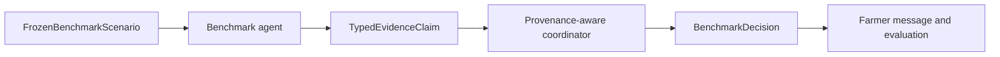
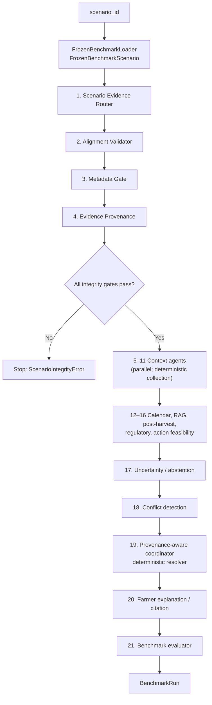
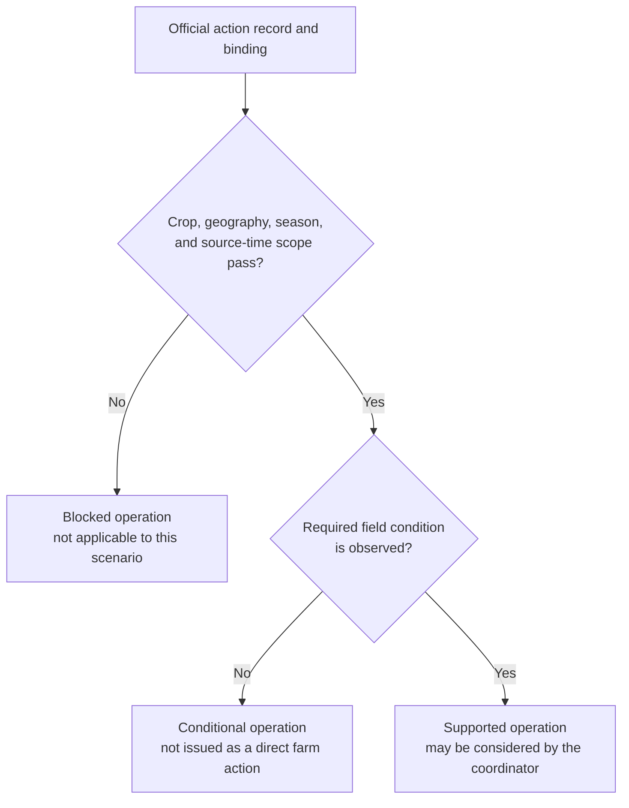
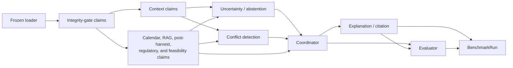

# Benchmark MAS Agent Reference

This document describes the **21-agent provenance-constrained MAS** used for
the frozen six-crop benchmark. It is separate from the original
pilot MAS: it begins with a validated frozen `scenario_id` and never accepts
arbitrary live weather, soil, market, image, or recommendation dictionaries.

Source code is in [`agents/benchmark/`](../agents/benchmark/), with one module
per agent. The orchestrator is
[`graph/benchmark_workflow.py`](../graph/benchmark_workflow.py).

## Purpose and safety boundary

The agents provide source-scoped regional context, conditional official
operations, conflict handling, citations, and safety status for six Indian
crops across 300 frozen scenarios. They do not turn public regional or
representative-cell data into a farm observation.

The current runtime does **not** issue a direct irrigation action,
farm-specific fertilizer dose, pesticide/insecticide treatment, disease
diagnosis, observed crop stage, or leaf-vision result. The 300 scenarios lack
the specific field evidence needed for those claims.

## Shared input and output contracts

### Root input: `scenario_id`

`BenchmarkMASWorkflow.run()` accepts:

```python
workflow.run(
    scenario_id,
    question="optional farmer or evaluation question",
    verify_raw_hashes=True,
)
```

`FrozenBenchmarkLoader` resolves the ID into one immutable
`FrozenBenchmarkScenario`. It joins the final registry, scenario manifest and
features, all four enrichments, regional operation-plan summaries/items/provenance,
post-harvest plan/context/provenance records, capability contract, RAG scope
matrices, operation bindings, and relevant recovered-source provenance. It fails closed on
identity, scope, coverage, canonical-row, or source-hash mismatches.

### Scoped recovered-operation access

All 300 runtime bundles include their source-linked regional plan. This gives
the calendar, fertilizer-baseline, crop-protection, feasibility, coordinator,
and renderer roles access to the planning items appropriate to that scenario.
The 92-document generic official RAG corpus remains separately
metadata-filtered. Recovered PAU/MPKV PDFs are not inserted into it.

Instead, the loader exposes a `retrievable_operation_passage` only when the
regional-plan operation's crop, geography, season, and source-time binding has
already passed. Agent 13 can rank that passage alongside metadata-admitted
generic chunks, while agent 15 uses the same plan item to emit the conditional
operation claim exactly once. This path is available for 229 scenarios;
PAU/MPKV recovery provenance and raw-artifact verification apply to the 99
scenarios that use those recovered sources. Neither path bypasses the missing
field-condition gate or enables a direct farm action.

### Scoped post-harvest and logistics access

The fourth enrichment is deliberately outside the generic 92-document corpus.
Each runtime bundle includes only crop-scoped source-quoted handling items,
exact-crop RAG passages, site facility-candidate context, recorded static-route
context, state infrastructure records, and hash-verified source/provenance
records for its own scenario. The loader verifies their hashes, identities,
profile/item relationships, candidate references, and exact-crop RAG scope.

The post-harvest agent may present conditional handling plan cards and
collection-date directory context. It cannot infer lot state, facility
availability, commodity acceptance, capacity, booking, dispatch, vehicle,
freight, storage duration, or a sell/hold outcome.

### Common agent output: `TypedEvidenceClaim`

Every agent emits one or more immutable typed claims.

| Field group | Purpose |
|---|---|
| `claim_id`, `scenario_id`, `agent_name`, `decision_domain` | A SHA-256 claim identity binds a statement to one scenario and comparable decision domain. Presentation-only bounded-LLM metadata cannot change this ID. |
| `disposition` | `context`, `supported_operation`, `conditional_operation`, `blocked`, `abstain`, or `no_data`. |
| `allowed_use` | Limits a claim to context, regional policy, conditional operation, regulatory lookup, or unavailable evidence. |
| `source` | Source document ID, official URL, raw path/hash, locator, and source role where available. |
| `spatial_scope`, `temporal_scope`, `quality` | Prevents use beyond the documented place, time, or quality boundary. |
| `gate_result`, `block_reason` | Records gate status; blocked, abstained, and no-data claims require a machine-readable reason. |
| `metadata` | Structured source values, restrictions, action conditions, trace fields, or retrieval details. |

The legacy `AgentEvidence` type remains unchanged for the pilot baseline and
is never used by these benchmark agents.



## Execution order and handoffs



The implemented LangGraph node order is:

1. `load_frozen_scenario`
2. `run_integrity_gates`
3. `run_context_agents`
4. `run_operations_path`
5. `run_safety_and_conflict_path`
6. `coordinate_provenance`
7. `render_and_evaluate`

## Agent catalogue

## Specific use of each agent

This table answers the practical question, “what does this agent add to this
particular benchmark run?”  An agent may make the output more useful to the
farmer, more auditable for the researcher, or both.  It must never extend its
use beyond the evidence and safety boundary stated below.

| # | Agent | Specific use in this MAS | It is not used to |
|---:|---|---|---|
| 1 | Scenario Evidence Router | Starts an admissible run from one frozen scenario and prevents live or caller-supplied facts from entering the benchmark trace. | Combine arbitrary farm inputs with frozen evidence. |
| 2 | Crop–District–Season Alignment Validator | Proves that the crop, district, state, season, date, site, and linked evidence belong to the same real-world scenario before any recommendation context is produced. | Repair or guess a mismatched record. |
| 3 | Metadata Gate | Gives every downstream agent its allowed evidence domains, so a regional source cannot silently become a farm-specific claim. | Grant permissions not present in the frozen capability contract. |
| 4 | Evidence Provenance | Makes every final citation traceable to its source ID, URL, raw artifact, hash, and locator for audits and paper reproducibility. | Re-fetch, update, or replace public-source evidence at runtime. |
| 5 | Weather Context | Adds the scenario's observed historical temperature, precipitation, and water-context card to explain regional conditions around the decision window. | Forecast weather or order irrigation. |
| 6 | Soil Context | Adds static SoilGrids texture/property context so regional plans are interpreted with documented soil background. | Treat gridded soil properties as a field soil test or prescribe N/P/K. |
| 7 | Satellite/NDVI Context | Adds quality-gated representative-cell NDVI trend context and supplies valid natural NDVI--weather divergence inputs to conflict analysis. | Identify the crop, diagnose disease, infer parcel condition, or infer crop stage. |
| 8 | Market Evidence | Adds a source-backed historical nearest-mandi price comparison card to the farmer-facing context. | Predict price or recommend selling, holding, storage, or quantity. |
| 9 | Fertilizer Baseline | Exposes the applicable official regional nutrient-schedule reference and clearly carries its farm-dose restriction into the final plan. | Calculate a personalized fertilizer dose. |
| 10 | Crop-Protection Safety | Exposes the applicable official IPM/regulatory guardrails and stops a registered product from being presented as an automatic treatment. | Diagnose a pest/disease or recommend a chemical application. |
| 11 | Vision Availability | Makes the absence of an aligned field image explicit, preventing the legacy mock-vision path from influencing a result. | Produce a leaf-disease prediction. |
| 12 | Regional Calendar / Operation Window | Supplies the crop--region--season timing reference that anchors seasonal, nutrient, and IPM plan cards. | Claim that the individual farm is at a particular observed growth stage. |
| 13 | Official Operations RAG | Retrieves and ranks only metadata-admitted official passages relevant to the frozen scenario and the user's question. | Retrieve out-of-scope documents or generate new operational facts. |
| 14 | Post-Harvest Storage & Logistics | Produces crop-scoped conditional handling cards and source-linked local infrastructure/route context, making post-harvest guidance realistic without promising services. | Assert harvest readiness, storage availability, booking, freight, dispatch, or sell/hold outcomes. |
| 15 | Regulatory Compliance | Preserves PPQS/CIBRC identifiers and source metadata so crop-protection material can be audited for regulatory context. | Authorize or prescribe chemical use. |
| 16 | Action Feasibility | Converts a scope-passed official operation into a source-quoted conditional or blocked operation claim, including its required field condition. | Remove an unobserved condition or issue a direct farm action. |
| 17 | Uncertainty / Abstention | Consolidates all missing-evidence and safety restrictions so the coordinator cannot overlook a blocked action domain. | Turn uncertainty into a recommendation. |
| 18 | Conflict Detection | Detects only same-domain, target-aligned evidence conflicts and eligible natural NDVI--weather divergences, creating stable records for the coordinator. | Invent disagreement from unrelated context claims. |
| 19 | Provenance-Aware Coordinator | Resolves admissible conflicts deterministically, ranks eligible plan cards, and produces the final cited decision with accepted, rejected, downgraded, and deferred evidence. | Let an LLM override source scope, safety policy, or field-condition gates. |
| 20 | Farmer Explanation / Citation | Renders the coordinator's approved regional operation, nutrient, IPM, post-harvest, and market context as a concise source-cited farmer message. | Add an uncited operation, diagnosis, booking, dispatch, or recommendation. |
| 21 | Benchmark Evaluator | Records per-run structural facts used by the external oracle and batch analysis: citations, action status, abstentions, and conflict-trace properties. | Claim field-outcome accuracy or modify the farmer decision. |

The first four agents establish whether a run is permitted; Agents 5–16
collect only allowed evidence; Agents 17–19 convert that evidence into a
safe, conflict-aware decision; and Agents 20–21 render and measure the
result.  Therefore, no agent is merely decorative: each has a defined effect
on either evidence admissibility, plan construction, safety, conflict
resolution, explanation, or evaluation.

### Bounded-LLM selection and final v5.1 evaluation boundary

Eight roles—Weather, Soil, Satellite/NDVI, Market, Fertilizer, Official
Operations RAG, Coordinator, and Farmer Explanation—may optionally make a
bounded LLM call **after** deterministic evidence admission. The LLM can only
rank or omit candidate IDs supplied by its role; it cannot create a claim,
change a source, relax a condition, issue a farm action, or resolve a
provenance conflict. The post-harvest agent remains deterministic.

The observed E1-v4 selector is retained as a historical local-model baseline.
The current experimental selector is v5.1, whose development stopped after
iteration 02. Its final model-quality measurement is the separate immutable
96-question held-out set at
[`data/llm_relevance_heldout`](../data/llm_relevance_heldout/). It is disjoint
from both earlier relevance sets at scenario and study-site level, locks the
v5.1 runtime hashes, and cannot be used for further prompt or candidate
packaging changes. See
[`BOUNDED_LLM_V5_HELDOUT_PROTOCOL.md`](BOUNDED_LLM_V5_HELDOUT_PROTOCOL.md).

### 1–4. Integrity and provenance gates

These agents run sequentially before any contextual interpretation. A `blocked`
claim from an integrity-gate agent causes the workflow to raise
`ScenarioIntegrityError`; no later agent runs.

| # | Agent / module | Input | Output | Downstream consumer / rule |
|---:|---|---|---|---|
| 1 | [Scenario Evidence Router](../agents/benchmark/scenario_evidence_router.py) | Validated scenario and manifest identity | `system_safety` context claim confirming the frozen scenario boundary | All later agents; no caller-provided live evidence is accepted. |
| 2 | [Crop–District–Season Alignment Validator](../agents/benchmark/crop_district_season_alignment_validator.py) | Scenario identity plus manifest, features, enrichment, regional-plan, and RAG-scope rows | Passing `system_safety` claim or blocked alignment claim listing mismatches | Workflow fail-closed check for crop, state, district, season, date, site, and scenario identity. |
| 3 | [Metadata Gate](../agents/benchmark/metadata_gate.py) | Per-scenario `mas_enrichment_contract.csv` row | `system_safety` claim containing permitted contexts and restricted action domains | All later roles must respect its capability restrictions. |
| 4 | [Evidence Provenance](../agents/benchmark/evidence_provenance.py) | Manifest raw paths, management source IDs, RAG scope, regional-plan provenance, recovered-source inventory, and passage counts | `system_safety` provenance claim | Coordinator and evaluator trace metadata; it never re-fetches a source. |

### 5–11. Restricted evidence/context agents

These seven agents execute concurrently only after all integrity gates pass.
Their outputs are collected in the listed order so the trace remains
reproducible.

| # | Agent / module | Input | Output | Safety boundary |
|---:|---|---|---|---|
| 5 | [Weather Context](../agents/benchmark/weather_context.py) | NASA POWER historical weather/water features, status, and manifest source reference | `weather_context` claim with exact-window temperature, precipitation, and modelled wetness | Historical/modelled representative-cell context only; no current moisture, irrigation history, forecast, or irrigation order. |
| 6 | [Soil Context](../agents/benchmark/soil_context.py) | Six frozen 0–5 cm SoilGrids registry records | `soil_context` claim with static gridded-property metadata, or `no_data` | Not a field soil test, field-moisture reading, or available farm N/P/K measurement. |
| 7 | [Satellite/NDVI Context](../agents/benchmark/satellite_ndvi_context.py) | Quality-gated Sentinel context/status, NDVI chronology/status, and satellite provenance | `satellite_context` claim with selected NDVI and trend metadata, or `no_data` | Not proof of crop identity, parcel condition, crop stage, disease, or irrigation need. |
| 8 | [Market Evidence](../agents/benchmark/market_evidence.py) | Exact frozen Agmarknet report features/status and source reference | `market_context` claim with published monthly comparison, or `no_data` | No price forecast, quantity, quality, storage-cost, or sell/hold instruction. |
| 9 | [Fertilizer Baseline](../agents/benchmark/fertilizer_baseline.py) | Regional management policy plus the regional nutrient plan item | Regional `fertilizer_baseline` context plus farm-dose abstention | Bounded LLM may prioritize an already-approved policy item or its farm-dose boundary; missing soil test and actual stage still block personalized fertilizer prescription. |
| 10 | [Crop-Protection Safety](../agents/benchmark/crop_protection_safety.py) | Regional protection policy, PPQS/CIBRC metadata, conditions, and regional IPM plan item | Policy context plus treatment abstention | A source/registration record is not a diagnosis, threshold event, or treatment order. |
| 11 | [Vision Availability](../agents/benchmark/vision_availability.py) | Leaf-vision capability permission | `no_data` claim | No aligned field leaf image exists; PlantVillage is separate. |

### 12–16. Official operation path



| # | Agent / module | Input | Output | Handoff / safety rule |
|---:|---|---|---|---|
| 12 | [Regional Calendar / Operation Window](../agents/benchmark/regional_calendar_operation_window.py) | Regional calendar row plus regional-plan summary/items/provenance | Calendar and source-linked regional-plan `regional_calendar` context claims | Coordinator uses regional timing/policy context only; neither claim is observed field stage or a direct action. |
| 13 | [Official Operations RAG](../agents/benchmark/official_operations_rag.py) | Metadata-admitted generic chunks, source-scoped crop-operation passages, exact-crop post-harvest passages, scenario scope, optional question | Retrieval claim plus `RetrievedPassage[]` labelled by corpus layer | Deterministic filtering admits the passage set first; bounded LLM may only re-rank it. Fourth-enrichment passages are exposed only after exact-crop scope passes. |
| 14 | [Post-Harvest Storage & Logistics](../agents/benchmark/postharvest_storage_logistics.py) | Crop-scoped handling profile/plan items, facility/warehouse candidate context, static-route and state-infrastructure context, source/provenance rows | Conditional `postharvest_logistics` handling claims plus collection-date infrastructure context | Never a harvest/readiness assertion, facility-availability/capacity claim, booking, dispatch, freight, transport, storage-duration, or sell/hold instruction. |
| 15 | [Regulatory Compliance](../agents/benchmark/regulatory_compliance.py) | PPQS/CIBRC IDs, URLs, hashes, locators, and policy status | `regulatory_context` claim | Regulatory compatibility is audit-time lookup only; never authorization to apply a chemical. |
| 16 | [Action Feasibility](../agents/benchmark/action_feasibility.py) | Combined action catalog/bindings and source-scoped regional-plan operation items | `conditional_operation` crop-operation claims with source quote and missing condition, or blocked claim | Creates only source-time-bound crop-operation claims. Agent 14 separately creates conditional technical handling claims. |

### 17–19. Safety, conflict handling, and coordination

| # | Agent / module | Input | Output | Handoff / safety rule |
|---:|---|---|---|---|
| 17 | [Uncertainty / Abstention](../agents/benchmark/uncertainty_abstention.py) | Capability contract plus all previous blocked, abstained, no-data, and conditional post-harvest claims | `system_safety` claim containing active restriction reasons | Retains both farm-action gates and post-harvest lot/harvest conditions. |
| 18 | [Conflict Detection](../agents/benchmark/conflict_detection.py) | Previous claims and optional natural NDVI divergence record | Stable-ID `ConflictRecord[]` via `detect()` plus a conflict-trace claim | Compares only claims with the same decision domain and target. It admits only eligible natural divergence candidates; it never manufactures a conflict from unrelated context or abstention. |
| 19 | [Provenance-Aware Coordinator](../agents/benchmark/provenance_aware_coordinator.py) | All prior claims, `RetrievedPassage[]`, and `ConflictRecord[]` | `BenchmarkDecision`, `ConflictResolutionRecord[]`, and coordinator trace claim | Deterministic policy applies safety, admissibility, geographic/temporal/source precedence, and safe deferral. Rejected/deferred claims cannot influence the decision or its citations; bounded LLM may only prioritize frozen plan-card order. |

### 20–21. Farmer-facing output and evaluation

| # | Agent / module | Input | Output | Handoff / safety rule |
|---:|---|---|---|---|
| 20 | [Farmer Explanation / Citation](../agents/benchmark/farmer_explanation_citation.py) | `BenchmarkDecision` and the coordinator’s claim set | Citation-preserving `farmer_message` in metadata plus trace claim | Renders source-scoped seasonal/nutrient/IPM and conditional post-harvest plan cards. Bounded LLM may select/order approved optional context; rendering cannot add an uncited action, booking, or dispatch claim. |
| 21 | [Benchmark Evaluator](../agents/benchmark/benchmark_evaluator.py) | `BenchmarkDecision` and claims through explanation stage | `BenchmarkEvaluationRecord` plus evaluation trace claim | Calculates lightweight in-workflow citation/abstention/action/conflict facts. The external [oracle evaluation guide](ORACLE_EVALUATION_GUIDE.md) independently performs the full source-derived policy checks; neither claims field accuracy. |

## Detailed data handoffs



| Producer | Consumer | Transferred data | Why it is needed |
|---|---|---|---|
| Loader | All agents | `FrozenBenchmarkScenario`, including regional/post-harvest plans, source inventories/provenance, facility/route context, generic RAG chunks, and scope-passed operation passages | Only immutable, aligned, source-checked evidence may enter an agent. |
| Integrity gates 1–4 | All later nodes | Passing gate claims and capability restrictions | A blocked integrity claim stops the graph; successful gates establish the allowed evidence boundary. |
| Context agents 5–11 | Agents 17–21 | Context, no-data, and abstention claims | Uncertainty aggregates restrictions; coordinator and explanation can describe only what they permit. |
| Agent 13 | Agent 19 | Ranked `RetrievedPassage[]` from admitted generic, crop-operation, and exact-crop post-harvest passages | Coordinator retains source identity, locator, and corpus-layer information in its trace. |
| Agent 14 | Agents 17, 19–21 | Conditional post-harvest handling and infrastructure-context claims | Preserves lot-condition and collection-date boundaries while enabling source-linked plan cards. |
| Agent 16 | Agents 17, 19–21 | Regional-plan-bound conditional/blocked crop-operation claims | Determines whether an official crop operation remains conditional or can be issued. |
| Agent 17 | Agents 19–20 | Consolidated restriction reasons | Ensures the decision and farmer message explain unavailable action domains. |
| Agent 18 | Agent 19 | Stable-ID `ConflictRecord[]` | The coordinator compares only these scoped conflicts; unrelated claims cannot be resolved by confidence alone. |
| Agent 19 | Agents 20–21 | `BenchmarkDecision` with `ConflictResolutionRecord[]` | Finalizes decision status, operation text, citations, uncertainty, and auditable accepted/rejected/downgraded/deferred claim handling. |
| Agent 20 | Agent 21 / `BenchmarkRun` | Farmer message and trace claim | Evaluation includes the rendered trace; caller receives the message. |

## Final runtime object: `BenchmarkRun`

| Field | Contents |
|---|---|
| `scenario_id` | Requested frozen benchmark identifier. |
| `claims` | All typed claims from the 21-agent trace, including explicit blocks, no-data, and conditional post-harvest plan claims. |
| `retrieved_passages` | Metadata-admitted official RAG passages plus scope-passed crop-operation and exact-crop post-harvest passages, each labelled by corpus layer. |
| `conflicts` | Valid same-domain conflicts or eligible non-action natural divergence candidates, each referencing stable claim IDs. |
| `decision` | Structured coordinator output, direct-action status, and per-conflict deterministic resolution traces. |
| `farmer_message` | Deterministic citation-preserving natural-language rendering. |
| `evaluation` | Structural trace-quality metrics, not field-outcome accuracy. |

## Evaluation-only conflict fixture registry

The 21-agent normal workflow never reads
[`data/conflict_fixture_registry`](../data/conflict_fixture_registry/). That
separate registry stores 60 labelled counterfactual overlays for evaluating
the existing Agent 18/19 detector-and-resolver path. The
[`ConflictFixtureRunner`](../evaluation/conflict_fixture_runner.py) first
loads the referenced real frozen scenario, then applies two test-only typed
claims in memory. It validates scope/time/provenance precedence, safety
precedence, equal-tie deferral, pre-coordinator identity/hash rejection, and
unrelated-domain non-conflicts.

Fixture claims are explicitly labelled
`evaluation_only_counterfactual_not_real_farm_evidence`, cannot issue a direct
farm action, and never appear in a farmer message. If a base scenario also has
a real NDVI--weather divergence, the runner records it as background context
instead of counting it as the fixture conflict.

This registry adds **no runtime agent** and no extra node to the LangGraph
workflow. It is an external evaluation harness that invokes the production
Agent 18 detector and Agent 19 coordinator with controlled in-memory claims.
Its required outcomes are:

| Fixture group | Cases | Verified component behaviour |
| --- | ---: | --- |
| Scope/time/provenance precedence | 30 | Retain the higher-precedence conditional claim and exclude the weaker claim from decision/citations. |
| Safety restriction precedence | 12 | Preserve the safety restriction and deny direct action. |
| Equal-precedence opposition | 6 | Record safe deferral rather than guess a winner. |
| Identity/hash mutation | 6 | Stop in production integrity validation before Agents 18–19. |
| Weather/market negative control | 6 | Produce no false same-domain conflict. |

The runner is invoked separately with
`ConflictFixtureRunner().run_all()`; it is never called by
`BenchmarkMASWorkflow.run()`.

## Evaluation-only provenance/alignment integrity fixtures

The normal 21-agent workflow also never reads
[`data/provenance_fixture_registry`](../data/provenance_fixture_registry/).
That second 60-case registry evaluates Agents 2 and 4's architecture boundary
without adding a 22nd runtime agent:

- 50 single-fault plan-item identity/binding fixtures are applied in memory;
  A0 must stop at Agent 2, while A5 is recorded as exposed because its
  evaluation-only definition deliberately omits Agent 2 and Agent 4.
- 10 raw-payload SHA-256 fixtures are stopped by the shared frozen loader
  before either A0 or A5 begins. This correctly attributes source-hash
  protection to the loader, not to the provenance-summary agent.
- The external runner halts at the integrity boundary. It never runs context
  agents, Agent 19, or the farmer renderer on an invalid bundle.

The protocol is implemented by
[`ProvenanceFixtureRunner`](../evaluation/provenance_fixture_runner.py) and
its independent
[`provenance fixture oracle`](../evaluation/provenance_fixture_oracle.py).
It passed 60/60 expected cases: 50 A0 alignment blocks, 50 A5 gate-boundary
exposures, 10 shared loader hash blocks, and zero direct actions. This is a
controlled software/provenance result, not an agricultural outcome metric.

## Current execution results

The workflow has been exercised across all 300 frozen scenarios:

| Result | Count |
|---|---:|
| Conditional operation traces, including post-harvest planning | 300 |
| Context-only traces | 0 |
| Conditional post-harvest plan items | 700 across 300 scenarios |
| Eligible natural NDVI cross-source candidates handled as non-action conflicts | 43 |
| Direct farm actions issued | 0 |
| Structurally safe traces | 300/300 |

The post-archive release-hygiene validation passes 193/193 tests (42.04
seconds). It includes individual-agent safety tests, metadata-scoped retrieval
tests, conditional-operation blocking, stable claim-ID/conflict-resolution
tests, all 60 stored fixture-policy cases, the A6 detected-but-unresolved
conflict-ablation boundary, a test that the workflow stops before context
agents run when an alignment gate is blocked, and read-only validation of the
official v2.2 comparison archives. Historical comparison/held-out tests now
use their official v2.2 or recoverable-archive paths; no agent authority or
frozen result archive changed.

## External oracle evaluation boundary

The source-derived `BenchmarkEvaluationOracle` is deliberately outside the
21-agent graph. It consumes the completed `BenchmarkRun` and the same immutable
`FrozenBenchmarkScenario`, then independently checks 20 source/policy/renderer
invariants. It cannot add evidence, call an agent, change a coordinator
decision, or alter the farmer message.

Its 300/300 in-memory audit passed all 20 checks and produced 72 immutable
crop/geography/evidence stratum rows. The separate fixture aggregate passed
60/60 expected resolver-policy outcomes. These are structural-conformance and
policy-compliance results—not field-action accuracy. See the
[evaluation policy](EVALUATION_POLICY.md) and
[oracle evaluation guide](ORACLE_EVALUATION_GUIDE.md) for the formal boundary,
all checks, and reproduction commands.

## Persisted architecture-comparison boundary

No agent was added, removed, or granted additional authority for the completed
A0–A6 comparison. The comparison is a read-only evaluator over the saved
`BenchmarkRun` and oracle artifacts, not a twenty-second runtime agent or a
second workflow. It verifies identical scenario IDs and frozen-input hashes
before reporting exact structural rates: A0 300/300, A1 0/300, A2 0/300, A3
71/300, A4 0/300, A5 300/300 on already-valid inputs, and A6 257/300. A5's
protective contribution is demonstrated only by its separate malformed-input
fixtures, not by its normal-input equality with A0.

The full tables, crop/district strata, fixture outcomes, source-artifact
manifest, and 300-dpi figures are in
[`results/v2_2-phase7-controlled-comparison`](../results/v2_2-phase7-controlled-comparison/). They
support claims about the contribution of workflow components to the frozen
structural contract; they do not change agent permissions or establish
farm-outcome accuracy.

The A0 300/300 rate is expected because normal inputs enter the 21-agent graph
only after frozen admission checks pass and A0 retains all gates. It is not the
agents grading themselves: the oracle executes after the graph, with a
separate result schema and no ability to affect a claim or decision. It is
also not independent agricultural ground truth, because it checks the same
frozen source/policy contract. Known-bad trace tests, A1–A6 removals, and the
A0/A5 malformed-bundle fixtures show that non-compliant paths are detected.

The A1–A6 scores are not agent-quality or agricultural-performance scores.
They identify which required part of the complete trace is absent: A1 lacks
coordinated operation handling, A2 lacks the multi-agent plan path, A3
withholds scoped operation recovery, A4 withholds regional plans, A5 removes
the valid-input gate boundary, and A6 withholds coordinator resolution while
retaining detection. The definitive configuration, fixture, and stratum
interpretation is in
[`RESULTS.md`](RESULTS.md#official-300-scenario-outcomes).

## Bounded LLM boundary

The benchmark has an optional bounded-LLM execution mode. With
`BENCHMARK_LLM_ENABLED=true`, exactly eight roles make one LLM invocation
attempt per scenario: Weather Context, Soil Context, Satellite/NDVI Context,
Market Evidence, Fertilizer Baseline, Official Operations RAG,
Provenance-Aware Coordinator, and Farmer Explanation/Citation. The adapter is
[`llm/benchmark_llm_client.py`](../llm/benchmark_llm_client.py).

The model receives immutable facts and may return only a subset of supplied
fact identifiers. Its response is validated and retained in the trace. An
accepted selection may re-rank already-admitted RAG passages, prioritize
frozen plan cards, select optional historical-context cards, or emphasize the
regional fertilizer-policy boundary. It cannot introduce a source, citation, agricultural value,
operation, dose, diagnosis, forecast, field observation, or free-form farmer
recommendation. Deterministic code remains the sole authority for a typed
claim’s disposition, allowed use, gate result, source citation, field-condition
requirement, direct-action status, and conflict resolution.

Each LLM-enabled agent owns its domain prompt through its
`llm_selection_instruction` class attribute in the corresponding agent
module. The shared LLM client adds the universal JSON schema, immutable-ID
constraint, question/topic context, frozen scenario identity, prompt hash, and
fallback behavior. The question and all retrieved fact text are explicitly
treated as untrusted data, so they may guide relevance only and cannot add an
instruction or relax a gate. The final runtime uses the hash-locked v5.1
selection contract, role-specific prompt wording, and candidate packaging;
their hashes and versions are retained in each bounded-LLM trace. Every prompt
has the same JSON-only output contract, but uses the following relevance
objective:

| Role | Allowed selection objective |
|---|---|
| Weather | Historical weather/water context relevant to the approved regional plan; never irrigation need or forecast. |
| Soil | Static SoilGrids context relevant to the plan; never field N/P/K, moisture, or a dose. |
| Satellite/NDVI | Quality-valid representative-cell NDVI context; never crop stage, disease, or parcel condition. |
| Market | Source-published historical comparison; never a forecast or sell/hold advice. |
| Fertilizer Baseline | Regional nutrient-plan reference or its field-dose limitation; never a dose calculation. |
| Official Operations RAG | Crop/geography/season/date/condition relevance within the already-admitted passage set only. |
| Provenance-Aware Coordinator | Priority of frozen plan cards only; never decision, scope, condition, or eligibility. |
| Farmer Explanation/Citation | Optional historical-context cards only; mandatory plan, safety, and citation content stays deterministic. |

The source-derived relevance evaluation set for these roles is frozen in
[`data/llm_relevance_benchmark`](../data/llm_relevance_benchmark/): 96
questions, 12 per role, over 12 six-crop anchor contexts. Its candidate facts,
passages, expected IDs, safety conditions, distractors, prompt hashes, and
source hashes are immutable. It evaluates ranking quality only; no agent gains
new authority from a relevance score. See
[`BOUNDED_LLM_RELEVANCE_BENCHMARK.md`](BOUNDED_LLM_RELEVANCE_BENCHMARK.md).

Offline/audit mode leaves `BENCHMARK_LLM_ENABLED=false`, preserving a fully
deterministic run. In bounded mode, an unavailable/invalid optional LLM call is
recorded as a safe fallback; `BENCHMARK_LLM_REQUIRED=true` makes the run fail
instead. This keeps safety-critical decisions outside model control while
allowing a controlled eight-call LLM ablation.

## Completed E1-v5 bounded-runtime evaluation

The same 21-agent graph was also executed with the accepted v5.1 bounded
selector. The bounded call can affect only the ranking, inclusion, or display
order of already-admitted IDs; it cannot change a typed claim, source,
condition, safety gate, action status, or conflict resolution. The final
held-out relevance result is 98.6% fact precision/recall, 100% safe-empty
accuracy, 100% exact RAG passage precision/recall, and zero invalid/fallback
events over 96 immutable questions. The accepted E1-v5 runtime then produced
30/30 pilot and 300/300 full-run external-oracle passes, with 2,400 accepted
bounded selections and zero direct farm actions.

The Phase 7 E0/E1 comparison verifies the same 300 ordered scenario IDs,
shared frozen data hashes, and oracle schema. It confirms that all 300
decision status, operation status/text, direct-action flags, and citation sets
are unchanged; only presentation of already-approved content may differ. The
six farmer-message pairs are qualitative inspection material, not a human
rating or agricultural accuracy result. See
[`results/v2_2-phase7-controlled-comparison`](../results/v2_2-phase7-controlled-comparison/).

## Phase 9 confirmation: no new agent and no weight fine-tuning

Reproducibility work added no agent, changed no agent permission, and
fine-tuned no model weights. Earlier E0/E1 semantic-repeatability evidence is
preserved as historical material. The final v2.2 clean-commit verification
reproduced all E0 traces and both fixture suites exactly, verified 57/57
frozen artifact hashes, and refreshed the bound E1 Metal evidence. It did not
alter the accepted E1 selection archive.

The only model-facing refinement in the project happened **before** final
evaluation: v5/v5.1 prompt and candidate-contract development on a separate
development set. It made selection sufficiency, safe-empty behavior, and
role-specific authority boundaries explicit. It did not alter the Qwen model
or grant any agent new decision authority. Details and metric formulas are in
[`Approach.md`](Approach.md#146-what-was-improved--promptcontract-refinement-not-model-fine-tuning).

## Phase 10 presentation boundary: no twenty-second agent

Phase 10 adds no twenty-second runtime role. Its read-only generator consumes
saved traces and this 21-agent contract after execution to create paper tables,
figures, and case studies in
[`results/v2_2-paper-artifacts`](../results/v2_2-paper-artifacts/). It cannot feed a
claim, retrieval, conflict, or farmer message back into the workflow.
