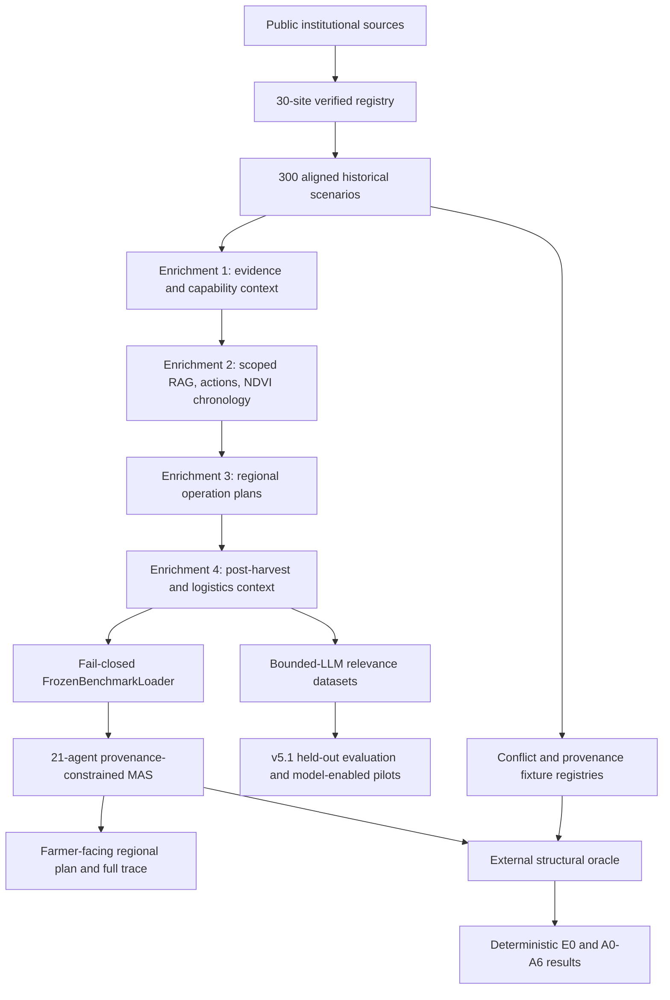
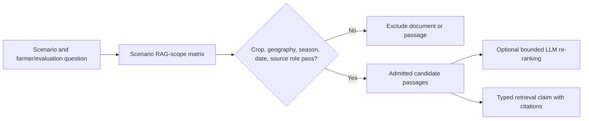
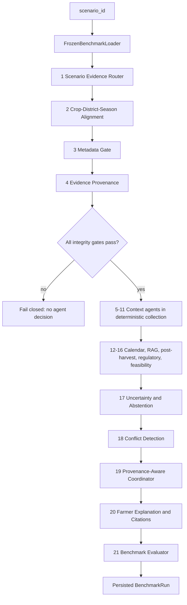

# End-to-End Implemented Approach

## 1. Purpose of this document

This document records the complete approach implemented so far for the
**Multi-Agent Smart Agriculture Decision System — A RAG-Grounded Multi-Agent
Framework for Multimodal Decision Support in Precision Agriculture**.

It is a methodology and implementation record, not a promise that public data
can observe an individual farm. It explains how the project moved from a
legacy smart-agriculture prototype to a reproducible, source-scoped, India
focused research benchmark; how the data, enrichments, RAG corpus, agents,
conflict system, and evaluation framework were constructed; and what is
complete versus still pending.

The authoritative public-source URLs, source restrictions, request metadata,
raw-payload paths, and hashes are in
[`DATA_SOURCES.md`](DATA_SOURCES.md). The agent-by-agent interface reference
is in [`AGENTS.md`](AGENTS.md), and the permitted research claims are defined
in [`EVALUATION_POLICY.md`](EVALUATION_POLICY.md).

## 2. Research problem and scope

The project addresses a common weakness in agricultural decision-support
systems: a response can sound useful while silently combining evidence from
different places, crops, seasons, dates, or sources. For example, a system
should not combine weather from one district, soil from another, an advisory
for a different crop, and a market price from an unrelated mandi, then present
the combination as a real farm recommendation.

The implemented system therefore asks a narrower, defensible question:

> Can a multi-agent system construct useful, source-cited **regional** crop
> operation plans from aligned public Indian data while enforcing evidence
> provenance, scope, safety boundaries, and deterministic conflict handling?

The answer is not framed as farm-level irrigation, disease, fertilizer-dose,
yield, or profit prediction. The frozen benchmark has no field moisture,
field soil test, measured crop stage, diagnosis/threshold event, aligned leaf
image, farmer adoption label, or yield label. The system consequently gives
source-backed regional plans and conditional official operations, while
refusing to fabricate farm-specific actions.

### 2.1 Research boundary

| Included | Deliberately excluded from the current research claim |
| --- | --- |
| Six representative Indian crops, 30 verified crop × district × season sites, 300 retrospective source-gated scenarios | All Indian crops, all districts, live farm monitoring, or a general national advisory service |
| Historical weather/water, static soil, representative-cell satellite context, historical mandi context, official regional guidance, RAG passages, and post-harvest context | Current field moisture, actual available N/P/K, observed crop stage, disease diagnosis, leaf vision, current warehouse capacity, booking, or transport availability |
| Regional plan cards and source-quoted operations that retain conditions | “Irrigate now,” exact fertilizer dose, pesticide treatment, diagnosis, sell/hold forecast, or facility booking |
| Provenance and structural-conformance evaluation | Agricultural outcome accuracy, yield impact, farmer adoption, or intervention effectiveness |

## 3. Design principles used throughout

The project was built around the following rules.

1. **Source before feature.** A feature is admitted only when its public
   source, request or document URL, retrieval metadata, raw payload, and hash
   are recorded.
2. **Alignment before reasoning.** Crop, state, district, season, decision
   date, representative cell, weather, soil, satellite, market, and advisory
   evidence must describe the same scenario boundary before an agent sees
   them.
3. **No synthetic agricultural facts.** Disease, weather, fertilizer,
   operation, market, and field-condition combinations are never invented to
   make a scenario look complete.
4. **Fail closed.** An identity, scope, hash, or evidence-contract mismatch
   stops the benchmark path rather than being repaired by inference.
5. **Public data is not a farm observation.** Representative-cell or regional
   information remains labelled as such throughout retrieval, coordination,
   and farmer rendering.
6. **LLMs are bounded selectors, not authorities.** They may prioritize
   already-admitted IDs; they cannot create evidence, change a citation,
   remove a condition, relax a gate, or choose a conflict winner.
7. **Evaluation must be separate from the coordinator.** The external oracle
   reads a completed trace but cannot influence the decision it grades.
8. **Controlled counterfactuals are not real farms.** Conflict and malformed
   provenance fixtures are evaluation-only in-memory overlays; they never
   enter normal farmer-facing runs.
9. **Results must state what they measure.** Structural conformance and
   bounded evidence-selection quality are not farm-outcome accuracy.

## 4. High-level implementation path



The order matters. Data quality and evidence admission happen before agent
reasoning; deterministic safety and provenance constraints happen before any
optional LLM selection; and external evaluation happens after the trace is
finished.

## 5. Stage 1 — Public-source collection and final site registry

### 5.1 Why the registry was created first

The first task was not to generate recommendations. It was to freeze a
realistic set of crop × location × season contexts so later weather, soil,
market, advisory, and RAG records would remain aligned. This prevents the
project from appearing realistic only on paper.

The final registry contains **30 admitted sites**: five sites for each of six
crops.

| Crop | Regional coverage | Verified districts |
| --- | --- | --- |
| Rice | Punjab Kharif | Ludhiana, Patiala, Sangrur, Mansa, Bathinda |
| Wheat | Punjab Rabi | Ludhiana, Patiala, Sangrur, Mansa, Bathinda |
| Maize | Tamil Nadu Rabi | Coimbatore, Erode, Salem, Namakkal, Ariyalur |
| Chickpea | Maharashtra Rabi | Jalna, Beed, Latur, Parbhani, Nanded |
| Soybean | Madhya Pradesh / Rajasthan Kharif | Indore, Ujjain, Dewas, Jhalawar, Baran |
| Tomato | Tamil Nadu Rabi | Krishnagiri, Dharmapuri, Salem, Dindigul, Coimbatore |

This design is deliberately neither a single-crop demonstration nor an
unbounded claim about all Indian agriculture. It provides cross-category
coverage—cereals, pulse, oilseed, and horticulture—while retaining enough
location-specific evidence for audit.

### 5.2 Public sources used for admission

The system uses only openly accessible or publicly published material. Major
source families are:

| Evidence need | Source family | Why it was used |
| --- | --- | --- |
| District geometry | geoBoundaries India ADM2 | Defines the district boundary for every site. |
| Representative cropland cell | ESA WorldCover class 40, accessed through Microsoft Planetary Computer | Ensures a representative location is cropland within the selected district. |
| Historical weather | NASA POWER daily point API | Supplies source-hashed historical weather and water context. |
| Static soil context | ISRIC SoilGrids WCS | Supplies globally consistent, static gridded soil properties. |
| Satellite metadata and NDVI source imagery | Sentinel-2 L2A through Microsoft Planetary Computer STAC | Supplies quality-gated representative-cell context and pre-decision NDVI chronology. |
| Crop/season profile | ICAR–CRIDA district crop contingency plans | Grounds crop–district–season compatibility and calendar context. |
| Historical mandi context | Agmarknet 2.0 monthly wholesale-price reports | Supplies historical, crop-aligned nearest-mandi interpretation. |
| Nutrient, calendar, IPM, and operations | PAU, TNAU, ICAR, IISR, MPKV, CRIDA/KVK material where scope passed | Supplies public regional guidance and source-quoted crop operations. |
| Chemical regulatory context | PPQS/CIBRC | Allows regulation metadata to be represented without treating registration as treatment authorization. |
| Post-harvest and storage context | Official crop handling, warehouse, cold-storage, and infrastructure publications/directories | Provides static, source-linked context without claiming live availability. |

The final source register gives exact URLs and usage restrictions. For
example, SoilGrids is explicitly static context—not available farm N/P/K;
NASA POWER is historical context—not a forecast; and directory listings do
not prove facility capacity, booking, or commodity acceptance.

### 5.3 Site-admission gates

A site entered the final registry only when its required evidence gates
passed. The exact per-site audit rows are stored under `data/registry/`.

| Gate | What was verified | Why it matters |
| --- | --- | --- |
| Crop–district–season compatibility | The selected crop is documented for the regional district/season context | Avoids assigning an implausible crop to a location/season. |
| District identity | A public administrative boundary resolves the named district | Prevents place-name ambiguity. |
| Representative cropland location | A WorldCover cropland cell lies inside that district | Keeps point-based sources tied to an agricultural location. |
| Weather availability | A fixed historical NASA POWER decision window is retrievable and hashed | Avoids untraceable weather values. |
| Soil availability | Required SoilGrids 0–5 cm property records are retrievable and hashed | Keeps static soil context complete and consistently sourced. |
| Satellite quality | A Sentinel scene/context satisfies the documented quality rule or is explicitly marked unavailable | Avoids treating poor imagery as evidence. |
| Mandi alignment | A historical same-crop market record is linked to the scenario’s nearest mandi/date context | Avoids unrelated commodity/market comparisons. |
| Management evidence | Calendar, nutrient/IPM policy, and regulatory/source-scope records are present where required | Provides a defensible regional planning basis. |

No site was frozen merely because it was geographically convenient. The
registry is the identity anchor for every later scenario, plan item, passage,
claim, trace, and evaluation stratum.

## 6. Stage 2 — Building the 300 aligned scenarios

### 6.1 Scenario composition

From the 30 admitted sites, the project created **300 immutable historical
contexts**: 50 per crop and 10 per site. The population includes 30 canonical
anchor scenarios and 270 additional source-gated historical contexts.

Each scenario is a fixed record of:

```text
scenario_id
  → crop, state, district, season, representative-cell/site identity
  → historical decision date
  → aligned weather, soil, satellite, and mandi evidence pointers
  → source hashes and evidence-status fields
  → management/RAG/operation permissions and capability restrictions
```

The canonical scenario manifest, features, and evidence-status table are the
only normal benchmark inputs. A caller cannot inject a new weather dictionary,
soil test, image, disease label, or recommendation into the benchmark path.

### 6.2 What “aligned” means operationally

Alignment is not a prose claim. It is represented in scenario fields and
checked repeatedly:

1. Crop, state, district, season, and representative site are fixed by the
   registry.
2. The decision date is fixed in the scenario manifest.
3. Weather, market, satellite, and enrichment rows use the same scenario ID
   and carry source references/hashes.
4. A regional plan item may enter only if crop, geography, season, source time,
   and scenario binding pass.
5. A source-scoped operation passage may be retrieved only after its binding
   passes.
6. The loader and alignment agent reject mismatched IDs, crop, district,
   season, date, site, raw payload, or canonical row.

This means that a public document may be useful to the project but still be
blocked for a particular scenario if its scope does not match.

### 6.3 Why scenarios are retrospective

The public evidence was collected and frozen around historical decision dates.
This supports reproducibility: the same data bundle can be loaded again and
its hashes can be checked. It does not claim to offer a live tomorrow forecast
or decision-time farm observation.

## 7. Stage 3 — Enrichment strategy

The scenario records alone establish identity and raw context, but they do not
provide all the structured evidence needed by a safe MAS. Four enrichments
were added. Each enrichment is source-linked, scenario-bound, audited, and
loaded by the same fail-closed loader. None creates synthetic conditions or
direct farm actions.

### 7.1 Enrichment summary

| Layer | Main additions | Why it was needed | Value added |
| --- | --- | --- | --- |
| First enrichment | Historical water/weather context, representative-cell satellite context, market context, MAS capability contract | Converts raw source records into typed context and explicit restrictions | Lets agents use context while knowing what that context cannot establish. |
| Second enrichment | Metadata-filtered official RAG corpus, action records/bindings, advisory discovery, pre-decision NDVI chronology | Makes official documents retrievable only within their legal scope | Supports cited retrieval, scoped operations, and natural context divergence analysis. |
| Third enrichment | Regional calendar, nutrient/IPM policy, and source-linked operation plan items | Converts scattered guidance into scenario-timed regional plan cards | Ensures all 300 scenarios have useful planning context and source-linked operations where evidence permits. |
| Fourth enrichment | Crop-scoped post-harvest handling, facility/warehouse/infrastructure context, static route context, exact-crop RAG passages | Extends the plan beyond in-season context without inventing logistics availability | Adds realistic handling and local infrastructure awareness while preserving safety. |

### 7.2 First enrichment — Evidence and capability context

The first enrichment transformed raw scenario evidence into agent-ready,
source-hashed records.

It includes:

- historical NASA POWER water/weather features;
- quality-gated Sentinel representative-cell context;
- source-backed historical Agmarknet market comparison features;
- scenario-specific capability restrictions;
- explicit `no_data`, `abstain`, and unavailable-domain information.

The key design decision was to preserve the distinction between **context** and
**authorization**. For example:

- historical precipitation can describe weather context but cannot prove
  current soil moisture or order irrigation;
- static soil texture can describe regional background but cannot prescribe an
  exact farm N/P/K dose;
- a representative-cell NDVI trend can describe a contextual divergence but
  cannot diagnose a crop disease;
- historical market prices can provide interpretation but cannot predict price
  or authorize selling/holding.

The per-scenario MAS enrichment contract makes these boundaries machine
readable before any agent starts.

### 7.3 Second enrichment — Official RAG, operations, and NDVI chronology

The second enrichment built the knowledge layer needed for grounded retrieval
instead of generic web-style RAG.

#### Official RAG corpus

The generic official RAG corpus contains **92 admitted documents** and **4,582
provenance-carrying chunks**. Every document/chunk records provider, official
URL, raw hash, crop/geography/period scope, locator, and use restriction.

A scenario-to-document scope matrix contains **27,600 scenario × source
decisions**. Retrieval therefore does not start by asking an LLM which public
documents "sound relevant." It starts with deterministic metadata filtering:



The optional LLM sees only the already-admitted candidates. It cannot broaden
scope by retrieving an unrelated crop, state, season, or time period.

#### Official action records and bindings

The enrichment also stores **41 source-quoted operation records** and
**12,300 scenario × action bindings**. Each action has a source quote,
conditions, source URL/hash/locator, and scope decision. An operation may be
available in the catalog but blocked for a particular scenario if the binding
does not pass.

#### Archived source recovery

Some historical official documents require careful recovery rather than a
simple current-page download. The project used transparent preservation copies
only when the original official source identity, archive capture, document
year, hash, quoted page, crop, geographic scope, season, and conservative
historical time window could all be verified.

This recovery added source-scoped material from PAU annual Kharif/Rabi
packages and MPKV *Krishi Darshani 2023*. It increased valid
source-quoted, condition-bound operation coverage to **229 of 300** scenarios.
It did not convert any condition into an observed farm fact.

Recovered PAU/MPKV passages are deliberately not dumped into the generic
92-document corpus. They are exposed only through scenario-specific operation
bindings after crop, geography, season, and source-time gates pass. This
prevents an otherwise legitimate PDF from being retrieved for an unrelated
scenario.

#### Pre-decision NDVI chronology

The second enrichment also retains pre-decision Sentinel NDVI time-series
features. They provide richer historical context and allow natural
NDVI–weather divergence cases to be recorded. They do not become parcel-level
crop-condition proof or automatic action evidence.

### 7.4 Third enrichment — Regional operation plans

The third enrichment was introduced because a safe system should not respond
with only “no data” when it has valid regional guidance. It converts official
calendar, nutrient-policy, crop-protection/IPM policy, and source-quoted
operation evidence into farmer-readable but scope-preserving plan items.

Current content includes:

- **1,507 source-linked regional plan items** across all 300 scenarios;
- seasonal calendar, regional nutrient-policy, and regional crop-protection
  policy cards for every scenario;
- **607 conditional source-quoted operation items** across the 229 scenarios
  with valid recovered/source-scoped operation coverage.

Each item carries crop, district/state scope, season, applicable time window,
method or quoted operation where documented, conditions, source ID, source
URL, locator, raw hash/provenance pointer, and allowed use.

The important distinction is between three output levels:

| Level | Example | Available in the benchmark? |
| --- | --- | --- |
| Regional operation plan | “The cited regional calendar/policy places this activity in the current seasonal window.” | Yes, for all 300 scenarios. |
| Time-valid conditional official operation | “Perform the source-quoted operation only after its cited maturity/dryness/field condition is true.” | Only for scenarios whose operation binding passes. |
| Farm-specific action | “Irrigate now” or “apply X kg/ha now.” | No; the required field observation is absent. |

This approach makes the output useful without misrepresenting a regional plan
as a personalized prescription.

### 7.5 Fourth enrichment — Post-harvest, storage, and logistics context

The fourth enrichment makes the system more realistic after crop handling
begins. It includes, for every scenario:

- crop-scoped source-quoted handling guidance;
- **700 conditional post-harvest plan items**;
- **14 exact-crop post-harvest RAG passages**;
- source-linked facility/warehouse candidate context;
- documented static route/proximity context; and
- state infrastructure records and provenance rows.

The post-harvest agent can say that documented drying, maturity, packaging,
grading, or storage conditions apply. It can also state that a source-listed
warehouse or cold-storage candidate exists as collection-date infrastructure
context. It cannot claim live capacity, commodity acceptance, booking,
freight, dispatch, storage duration, or a sell/hold outcome, because public
directories do not consistently establish those facts for every scenario.

The fourth enrichment is deliberately separated from the generic RAG corpus.
Exact-crop handling passages are exposed only after crop-specific scope checks
pass, avoiding accidental use of a post-harvest recommendation for the wrong
commodity.

## 8. Stage 4 — Converting evidence into an implementable MAS

### 8.1 Preserve the legacy baseline; build a new benchmark path

The repository had an earlier prototype that accepted caller-supplied or demo
weather, soil, market, and vision input. That legacy system is preserved for
historical comparison but cannot supply the research benchmark because it does
not enforce the frozen scenario/evidence boundary.

The implemented benchmark path is separate:

| Legacy prototype | Current benchmark MAS |
| --- | --- |
| Arbitrary/demo input dictionaries may enter the workflow | Only a validated frozen `scenario_id` enters the workflow |
| Generic evidence representation | Typed claims with source, scope, allowed-use, disposition, conditions, and block reason |
| Legacy/mock-style vision path exists separately | Vision Availability explicitly returns `no_data` for the benchmark |
| May be useful as a historical demo | Not used for current paper results |

The active implementation is centered on `FrozenBenchmarkLoader`, typed
evidence schema objects, `agents/benchmark/`, the benchmark LangGraph
workflow, and `BenchmarkRun` output persistence.

### 8.2 The fail-closed loader

Given a scenario ID, the loader joins only canonical records from:

- final site registry;
- scenario manifest, features, and evidence status;
- all four enrichments;
- capability contract;
- RAG-scope matrices and retrieved-operation scope;
- regional operation-plan items/provenance;
- post-harvest plan/context/provenance;
- official action bindings; and
- raw-source and recovered-document integrity metadata.

It verifies IDs, canonical rows, raw source hashes, crop, state, district,
season, decision date, site, scope, coverage, and linked-record identity. A
mismatch raises an integrity error and prevents all later agents from running.

### 8.3 Typed evidence claims

Every agent output uses a typed, immutable evidence claim rather than an
unstructured recommendation string.

| Claim field | Role in the approach |
| --- | --- |
| Claim ID and scenario ID | Bind a statement to a specific scenario; IDs are stable for auditing. |
| Agent and decision domain | Lets the system compare only claims about the same target/domain. |
| Disposition | Distinguishes context, supported operation, conditional operation, blocked, abstain, and no-data. |
| Allowed use | Prevents a regional policy or context card from becoming a farm action. |
| Source/citation fields | Preserve source ID, URL, hash, locator, and source role. |
| Geographic/temporal scope | Preserves where and when the source applies. |
| Conditions and block reasons | Keeps missing field conditions visible rather than silently omitted. |
| Metadata | Stores source values, retrieval details, trace decisions, and restrictions. |

## 9. Stage 5 — Agent architecture and workflow

### 9.1 Why use multiple agents

A single generic planner would mix several tasks: data admission, alignment,
source filtering, weather interpretation, soil context, retrieval, operation
feasibility, uncertainty, conflict handling, explanation, and evaluation.
Separating them makes permissions auditable. Each agent has a narrow purpose,
input boundary, output type, and explicit non-permitted behavior.

### 9.2 Workflow path



The first four roles are gates, not advisors. If they fail, context and
planning roles never execute. The context agents collect only permitted
evidence. Feasibility and uncertainty preserve action restrictions. Conflict
handling happens only after claims have been typed and scoped. The coordinator
accepts/rejects/degrades evidence deterministically before the farmer message
is rendered.

### 9.3 The 21 agents and why each exists

| # | Agent | Reason for inclusion and implemented contribution |
| ---: | --- | --- |
| 1 | Scenario Evidence Router | Starts only from a frozen scenario and blocks caller-supplied/live facts. |
| 2 | Crop–District–Season Alignment Validator | Checks that crop, geography, season, date, site, and linked evidence all belong together. |
| 3 | Metadata Gate | Distributes allowed-use permissions and restricted domains to later agents. |
| 4 | Evidence Provenance | Carries source identity, URL, raw hash, locator, and source role into the trace. |
| 5 | Weather Context | Supplies observed historical weather/water context; never forecast/irrigation authority. |
| 6 | Soil Context | Supplies static SoilGrids background; never field-test or N/P/K-dose authority. |
| 7 | Satellite/NDVI Context | Supplies quality-gated representative-cell NDVI context and natural divergence inputs; never diagnosis/stage proof. |
| 8 | Market Evidence | Supplies historical nearest-mandi interpretation; never price forecast or sell/hold authority. |
| 9 | Fertilizer Baseline | Shows regional nutrient-policy context and the field-dose restriction together. |
| 10 | Crop-Protection Safety | Preserves IPM/regulatory context while blocking diagnosis-less chemical treatment. |
| 11 | Vision Availability | Makes the missing aligned leaf image explicit and blocks the legacy mock-vision route. |
| 12 | Regional Calendar / Operation Window | Supplies source-linked seasonal timing and plan-card context. |
| 13 | Official Operations RAG | Retrieves only metadata-admitted generic, source-scoped, or exact-crop passages. |
| 14 | Post-Harvest Storage & Logistics | Produces conditional handling guidance and static infrastructure context without promising services. |
| 15 | Regulatory Compliance | Preserves PPQS/CIBRC source metadata for audit; never authorizes chemical use. |
| 16 | Action Feasibility | Turns a scope-passed official operation into a conditional/blocked claim while retaining its condition. |
| 17 | Uncertainty / Abstention | Consolidates missing-evidence, no-data, and safety reasons. |
| 18 | Conflict Detection | Finds only same-domain, same-target contradictions and records eligible divergences. |
| 19 | Provenance-Aware Coordinator | Resolves eligible evidence deterministically and produces the final cited decision trace. |
| 20 | Farmer Explanation / Citation | Converts approved plan cards into concise source-cited farmer language without adding facts. |
| 21 | Benchmark Evaluator | Produces structured runtime facts for the external oracle; it cannot change the decision. |

## 10. Stage 6 — Decision safety and farmer-facing output

### 10.1 Conditional operations rather than fabricated prescriptions

An official operation can be useful without becoming an unsupported command.
The Action Feasibility agent checks the operation’s scenario binding and keeps
the document’s conditions. When a required farm condition is unobserved, it
emits a conditional operation—not a direct farm action.

For example, an admissible official harvest operation may remain conditional
on documented maturity and dryness. The system can preserve that technical
condition and cite the source; it cannot claim the individual crop is mature
or dry merely because the calendar window matches.

### 10.2 Output hierarchy

The coordinator organizes the final message as a prioritized regional plan:

1. regional crop operation/calendar card;
2. regional nutrient-policy card and its farm-dose boundary;
3. regional IPM/crop-protection guardrail;
4. source-quoted conditional operation if a scenario binding passes;
5. conditional post-harvest handling/context if relevant; and
6. historical market context where an exact report supports it.

Restrictions remain in the technical trace unless they are necessary to avoid
misleading the farmer. This avoids a message dominated by repeated “no” while
still preventing the system from presenting regional context as a personalized
farm command.

### 10.3 Direct farm-action boundary

For the current frozen evidence, the following remain unavailable for every
scenario:

- immediate irrigation order;
- exact field-specific fertilizer dose;
- diagnosis or disease threshold event;
- pesticide/insecticide treatment order;
- vision-based disease result;
- live facility/transport booking or sell/hold advice.

These are not failures of the agents. They are necessary boundaries given the
evidence actually available.

## 11. Stage 7 — Conflict awareness and provenance handling

### 11.1 Why conflict handling was added

Calling a system “conflict-aware” requires more than storing several agent
outputs. The system must identify comparable disagreement, apply a declared
policy, explain the outcome, and ensure rejected evidence cannot influence the
final plan.

The benchmark contains 43 genuine NDVI–weather contextual divergences. They
are retained as natural evidence differences, but they do not create direct
farm actions because neither source is field-level action authority.

### 11.2 Eligibility rule

Claims are comparable only when they refer to the same decision domain and
target. A weather-context statement and a market-context statement are not a
conflict simply because their implications sound different. This avoids
manufacturing conflicts to make the architecture appear more complex.

### 11.3 Deterministic coordinator policy

For eligible conflicts, the coordinator applies this policy in order:

1. A source-scoped opposing safety restriction blocks the contested action.
2. Blocked, unavailable, abstained, and out-of-gate claims cannot win.
3. Remaining claims are ranked by gate result, geographic specificity,
   temporal specificity, source provenance, claim disposition, and recorded
   confidence.
4. Equal-precedence opposition is safely deferred; no LLM breaks the tie.

The trace records comparable claim IDs, target, policy rule path, accepted,
rejected, downgraded, and deferred IDs, plus citations and safety status.

### 11.4 Conflict fixture registry

Real 300-scenario evidence does not guarantee enough controlled contradictions
to test every resolver branch. A separate 60-case conflict registry was
therefore created from real base-scenario identities with labelled in-memory
provenance/scope/time/safety overlays. It is evaluation-only and introduces no
new agricultural observation.

| Fixture family | Cases | Purpose |
| --- | ---: | --- |
| Scope, temporal-validity, and provenance precedence | 30 | Verify retention of the higher-precedence claim. |
| Safety restriction precedence | 12 | Verify the restriction wins and direct action stays blocked. |
| Equal-precedence opposition | 6 | Verify safe deferral rather than arbitrary selection. |
| Identity/hash integrity mutation | 6 | Verify fail-closed blocking before coordination. |
| Unrelated-domain negative control | 6 | Verify no false weather-versus-market conflict is invented. |

The full A0 system matches the stored policy in 60/60 fixtures. This is a
policy-compliance result, not a label for real agronomic outcome correctness.

### 11.5 Provenance/alignment integrity fixture registry

A second 60-case registry measures the protective value of evidence gates,
rather than the conflict policy. Every case begins with a real frozen scenario
and applies exactly one in-memory fault:

| Fault family | Cases | Expected comparison |
| --- | ---: | --- |
| Crop, district, season, date, or scenario-plan binding mismatch | 50 | A0 blocks at the alignment validator; A5 exposes the omitted-validator boundary in evaluation-only mode. |
| Weather raw-payload hash mismatch | 10 | Both A0 and A5 block at the shared loader hash verifier. |

This distinction is important: A5’s 300/300 normal-input score is expected
because the normal data were already valid. Its missing protection becomes
visible only when controlled malformed evidence is presented.

## 12. Stage 8 — Oracle and research evaluation approach

### 12.1 Why an external oracle was necessary

The coordinator cannot grade itself. The project therefore implements a
separate read-only `BenchmarkEvaluationOracle` that consumes a completed
`BenchmarkRun` and emits per-run and aggregate results. It cannot alter a
claim, coordinator decision, citation, or farmer message.

The oracle derives expected facts and restrictions from the same frozen public
evidence and policy contract. It is independent of runtime control flow, not
independent agricultural ground truth. Therefore a high oracle score means
conformance with the stated evidence/safety contract—not agricultural
effectiveness.

### 12.2 What the structural oracle checks

The current Oracle v1.4 implements **20 binary structural checks**, including:

- input lineage and stable claim identity;
- crop/district/season/date scope compliance;
- citation traceability, context-source binding, and source/URL/hash/locator fidelity;
- metadata-scoped RAG compliance;
- operation-binding and condition fidelity;
- conditional-operation completeness;
- grounded regional-plan coverage and selected-operation citation coverage;
- farmer-message condition/citation and source-detail/facility fidelity;
- agent-permission and unsupported-action prevention;
- abstention/no-data reason coverage;
- conflict-trace completeness, rejected/deferred-evidence exclusion, and
  conflict-resolution citation fidelity;
- natural NDVI–weather divergence policy;
- no-image vision boundary;
- bounded-LLM trace validity when enabled.

The Oracle's aggregate report adds one derived `overall_structural_pass` row
only when all 20 checks pass. Deterministic repeatability fingerprints are
persisted alongside the checks, but are a separate reproduction mechanism,
not a twenty-first Oracle check. Exact check names, formulas, source data, and
denominators are in [RESULTS.md](RESULTS.md#exact-metric-formulas-denominators-and-input-data).

Results are stratified across 72 frozen crop/geography/season/evidence
groups so an aggregate result cannot conceal a weak crop or location group.

### 12.3 Why 100% deterministic conformance is expected

The normal 300-scenario population was admitted only after source, identity,
scope, and hash gates passed. E0 executes the complete deterministic
architecture with all required gates and no LLM calls. Its A0 score of
300/300 therefore means that implementation preserved the frozen contract.

It does **not** mean 100% agricultural accuracy. The tests, ablations, and
malformed-input fixtures demonstrate that the same oracle can fail when a
required architecture component or evidence rule is removed.

## 13. Stage 9 — Experimental configurations and ablations

### 13.1 E configurations: model/runtime experiments

The project has **E0 through E3**. There are currently no E4 or E5
configurations; if new ones are added later, they must be pre-registered and
must not be retroactively inserted into existing comparisons.

| ID | Backend/model | Purpose | Current state |
| --- | --- | --- | --- |
| E0 | No LLM; deterministic full MAS | Reference conformance, reproducibility, and bounded-LLM control | Completed over 300 scenarios. |
| E1 | Ollama/Metal, Qwen2.5 7B Instruct Q4_K_M | Local bounded-LLM baseline and final v5.1 path | Final held-out, 30-site pilot, and 300-scenario E1-v5/A0 run completed; v4 remains historical only. |
| E2 | Ollama/Metal, Qwen2.5 14B GGUF Q4_K_M | Model-capacity transfer experiment | Apple-GPU preflight passed, but the 96-question transfer gate failed (9.375% invalid structured outputs); no pilot or 300-run. |
| E3 | MLX-LM/Apple GPU, Qwen2.5 14B MLX 4-bit | Deployment-backend transfer experiment | Apple-GPU preflight passed, but the transfer gate failed (25.0% invalid structured outputs); no pilot or 300-run. |

E2 and E3 cannot be described as a runtime-only comparison: their GGUF and
MLX artifacts are not byte-identical, and Ollama does not expose the upstream
revision/tokenizer-file hash needed to establish equivalence. They are recorded
as deployment-backend transfer experiments only. Their schema-rejection
failures are preserved without v5.1 tuning; see
[`PHASE8_14B_EXPERIMENTS.md`](PHASE8_14B_EXPERIMENTS.md).

### 13.2 A configurations: architecture comparisons

The A systems are controlled component-removal experiments. All use the same
frozen 300 scenarios and external oracle; A1–A6 are evaluation-only and are
not farmer-facing systems.

| ID | System | What it tests | Persisted normal result |
| --- | --- | --- | ---: |
| A0 | Full deterministic MAS | Complete proposed evidence/planning/provenance/conflict path | 300/300 |
| A1 | Regional-operation-plan-only | Value of coordinated multi-agent handling beyond plan cards | 0/300 |
| A2 | Centralized source-filtered RAG | Value of typed multi-agent decomposition beyond retrieval | 0/300 |
| A3 | MAS without scoped RAG/recovered operations | Value of source-scoped operation recovery | 71/300 |
| A4 | MAS without regional operation plans | Value of the third enrichment | 0/300 |
| A5 | MAS without provenance/alignment validator | Value of strict identity/scope checks | 300/300 on valid normal inputs; gate loss shown by fixtures |
| A6 | MAS without conflict coordination | Value of coordinator conflict handling | 257/300 |

The A6 result differs from A0 by the 43 natural NDVI–weather divergence traces
whose coordinator resolution is intentionally withheld. It retains detection
and safety rules but cannot satisfy the required resolution-trace property.

### 13.3 Completed deterministic evidence

The following results are already persisted:

- E0/A0: 300/300 normal structural-oracle passes and 60/60 conflict-policy
  fixture passes;
- A1–A5: completed 300-scenario evaluation-only ablations;
- A6: 257/300 normal structural passes; detects all 48 coordinator-required
  controlled conflicts but resolves 0/48 by design;
- provenance/alignment fixtures: 60/60 expected outcomes, including 50 A0
  alignment blocks, 50 A5 omitted-gate exposures, and 10 shared payload-hash
  blocks;
- source-hash-validated cross-run report: six tables, crop/district strata,
  and three 300-dpi PNG/PDF figures.

These are architectural and safety-policy findings. They are not claims that
one system improves farmer yield or makes more accurate field actions.

For the full research rationale behind each E-run and A-run—including what
each removes or changes, why it was required, which comparisons are valid,
and what each result does and does not establish—see
[EXPERIMENT_RUNS_GUIDE.md](EXPERIMENT_RUNS_GUIDE.md).

## 14. Stage 10 — Bounded LLM approach: v4, v5, v5.1, and held-out testing

### 14.1 Why an LLM is optional and bounded

The core safety path is deterministic. An LLM is useful only for choosing which
already-admitted context, passage, or plan card should be emphasized. It is
not permitted to generate an operation or resolve a safety conflict.

Eight roles may make bounded selections:

1. Weather Context;
2. Soil Context;
3. Satellite/NDVI Context;
4. Market Evidence;
5. Fertilizer Baseline;
6. Official Operations RAG;
7. Provenance-Aware Coordinator; and
8. Farmer Explanation/Citation.

The post-harvest agent is intentionally deterministic because it establishes
the admissible handling/infrastructure evidence itself; adding an LLM would
not improve its evidence boundary.

### 14.2 E1-v4 observed local-model baseline

The original E1-v4 relevance benchmark used 96 source-derived questions and
the local Ollama Qwen2.5 7B model. Its result is preserved as a baseline, not
discarded. It showed that a local model could often select obvious context,
but had weak safe-empty behavior, broad RAG selection, and fertilizer-boundary
ranking errors.

This was valuable diagnostic evidence. It motivated a separately versioned
improvement rather than changing the benchmark after observing the result.

### 14.3 V5 design

V5 introduced role-specific prompts and candidate packaging. Its central rule
is **decision sufficiency before topical relevance**:

> Return no ID when no supplied candidate is sufficient for the exact requested
> decision, even if a candidate is topically related.

It also introduced:

- visible `allowed_use` and `does_not_establish` boundaries;
- context-role safe-empty behavior for unsupported farm actions;
- fertilizer ordering that keeps the field-dose boundary before regional
  policy when dosage is discussed;
- one exact source-scoped operation for RAG questions;
- one primary plan card for coordinator questions; and
- an explanation role that cannot use optional context to authorize a farm
  action.

V5 was developed only on a separate source-derived development set. Its
outputs are explicitly marked development-only and cannot become final paper
results.

### 14.4 V5.1 refinement and freeze

V5.1 refined the selection contract after development evidence, particularly
the request-sufficiency marker and fertilizer boundary packaging. The frozen
contract records:

| Item | Frozen v5.1 value |
| --- | --- |
| Selection contract | `v5.1-sufficiency-primary-selection-contract-2` |
| Prompt version | `bounded-selection-v5.1-sufficiency-primary-candidate-contract` |
| Candidate packaging | `v5.1-role-aware-candidate-packaging-2` |
| LLM authority | Rank or omit supplied IDs only |
| Authority over actions, gates, sources, conditions, citations, conflicts | None |

Development stopped after iteration 02. The 96-question development set is
preserved as development evidence only; it is not the final result.

### 14.5 Final v5.1 held-out relevance benchmark

To measure v5.1 without reusing development questions, a new immutable
96-question held-out set was created.

| Aspect | Implemented approach |
| --- | --- |
| Roles | 12 questions for each of the same eight bounded roles. |
| Unseen sites | Bathinda rice, Bathinda wheat, Ariyalur maize, Nanded chickpea, Baran soybean, and Coimbatore tomato. |
| Contexts | Two date-specific contexts per unused site, 12 total. |
| Disjointness | No scenario or study-site overlap with E1-v4 or v5 development. |
| Safe-empty tests | 30 questions testing rejection of context that does not authorize the requested action. |
| RAG tests | 12 questions name one actual source-scoped operation and its required condition. |
| Candidate facts | Only source-backed, same-scenario admitted facts/passages/cards. |
| Integrity | Question, criteria, evidence, and v5 runtime hashes are checked on load. |
| Tuning policy | No v5.1 prompt/candidate/label/threshold changes after final evaluation. |

The acceptance thresholds were registered before any final held-out LLM call:

| Metric | Requirement |
| --- | ---: |
| Fact-selection precision and recall | at least 80% each |
| Safe-empty selection accuracy | at least 80% |
| Exact RAG-passage precision and recall | at least 75% each |
| Invalid structured-output rate | at most 2% |
| Fallback rate | at most 2% |

The final runner subsequently executed **once** against this untouched set,
using Ollama, `qwen2.5:7b-instruct`, temperature `0.0`, and the bound Q4_K_M
artifact. It passed the pre-registered thresholds: 98.6% fact-selection
precision/recall, 100% safe-empty accuracy, 100% exact RAG passage
precision/recall, and 0% invalid/fallback events. No prompt, candidate
package, source, label, or acceptance threshold was changed afterward.

### 14.6 What was improved — prompt/contract refinement, not model fine-tuning

The project did **not** fine-tune, train, LoRA-adapt, or otherwise change the
weights of Qwen2.5. The local model remains the published Ollama
`qwen2.5:7b-instruct` Q4_K_M artifact identified by its frozen blob hash.
Calling this “model fine-tuning” would be incorrect.

Instead, the engineering improvement was a controlled **prompt and candidate
selection-contract refinement**:

1. The original 96-question E1-v4 benchmark exposed three failure modes:
   topical-but-insufficient evidence was selected instead of safe-empty;
   RAG sometimes selected broadly related passages instead of the one
   source-scoped operation; and fertilizer selection could foreground a
   regional policy before its no-field-dose boundary.
2. A separate 96-question development set, disjoint from the original v4
   questions, was created. Development examples were source-derived and
   retained the candidate IDs, expected IDs, distractors, conditions, and
   scenario identity; they were never agricultural outcome labels.
3. V5 changed candidate packaging and role instructions—not the model. Every
   selection request exposed explicit `allowed_use` and
   `does_not_establish` boundaries, required a JSON list of supplied IDs only,
   and made “return `[]`” the correct answer when evidence was insufficient.
4. Role-specific contracts replaced generic topical ranking: fertilizer
   prioritizes its field-dose boundary before regional policy; official RAG
   selects one exact source-scoped operation; the coordinator selects one
   approved primary plan card; context/explanation roles cannot convert
   optional context into farm-action authority.
5. V5.1 added the visible request-sufficiency marker and the final
   role-aware candidate packaging. Development ended after iteration 02.
6. A newly created held-out set, disjoint from both v4 and development sites/
   scenarios, was evaluated exactly once. Its results are the reported
   selection-quality values; development iterations are not presented as
   final research results.

This approach makes the LLM more reliable at *selecting already admissible
evidence*. It never gives the LLM power to create a source, alter a gate,
remove a condition, resolve a conflict, or issue a direct farm action.

### 14.7 Exact metric definitions for reported percentages

Let `N` be the number of eligible evaluation instances. For a set of selected
IDs, `TP` means an admitted expected ID selected by the system, `FP` an
unadmitted/distractor ID selected, and `FN` an expected ID omitted.

| Reported value | Formula | Current use and boundary |
| --- | --- | --- |
| Fact-selection precision | `TP / (TP + FP)` | Held-out relevance selection only. |
| Fact-selection recall | `TP / (TP + FN)` | Held-out relevance selection only. |
| Exact RAG passage precision/recall | Same formulas restricted to named admissible RAG passage IDs | Tests exact source-scoped operation retrieval, not agricultural correctness. |
| Safe-empty accuracy | `correct empty selections / safe-empty questions` | Tests refusal to treat insufficient context as action authority. |
| Plan/operation selection accuracy | `exact expected plan/operation selections / eligible questions` | Used only where a question has one source-derived expected card/operation. |
| Invalid-output rate | `schema-invalid LLM responses / all LLM responses` | A malformed JSON/ID response is not silently accepted. |
| Fallback rate | `safe fallbacks / all LLM responses` | A fallback is visible and never a synthetic answer. |
| Structural oracle pass rate | `all-20-check scenario passes / scenario count` | E0/E1/A0–A6 contract conformance, not farm accuracy. |
| Fixture-policy compliance | `fixture records matching declared policy / fixture count` | Controlled conflict or malformed-evidence software policy tests. |
| Reproducibility match rate | `exact normalized semantic trace matches / 300` | Phase 9 source/trace repeatability. Timing/RSS are intentionally excluded. |

For the final held-out set, the aggregate 98.6% is the computed proportion
over all eligible fact-selection decisions (not a rounded model “accuracy”
label). The 100% values mean every eligible safe-empty or named RAG-passage
case met its source-derived expected selection. These values must never be
renamed irrigation, fertilizer, disease, yield, or farmer-outcome accuracy.

## 15. Stage 11 — Apple GPU and reproducibility approach

### 15.1 Apple GPU evidence

The local E1 configuration is Qwen2.5 7B Instruct, Q4_K_M through Ollama on
Apple Silicon. Apple acceleration is verified using Ollama’s own Metal/GPU
residency observation, not `torch.backends.mps.is_available()`, because Ollama
does not use the project’s PyTorch device path.

The preflight records host architecture, unified memory, Ollama version, model
tag, digest, artifact hash, quantization, a valid JSON probe, and non-zero
GPU-resident model bytes. This proves the intended artifact can run on the
local Apple GPU; it is not itself an agricultural or MAS result.

### 15.2 Reproducibility controls

Every persisted experiment is designed to save:

- Git commit and clean-worktree status;
- frozen scenario/registry/enrichment/RAG/operation source hashes;
- prompt, candidate-packaging, and runtime hashes;
- model backend, model revision/digest/artifact hash, quantization, and
  generation settings;
- host and Apple GPU evidence;
- complete `BenchmarkRun`, trace, citations, selected IDs, farmer message,
  conflict records, and oracle result;
- latency, peak memory, invalid-output, and fallback measurements; and
- aggregate, crop/location-stratified, and configuration-level summaries.

The batch runner rejects altered protocol artifacts, dirty required runs,
unknown scenario IDs, altered pilot sets, and existing output directories. A
clean-checkout reproduction later verifies deterministic E0 fingerprints and
records model-enabled repeatability under the same bound artifact.

## 16. Current project state and next execution path

### 16.1 Implemented and frozen

- 30/30 registry sites and 300/300 aligned scenarios;
- all four enrichments, source documents, RAG scope, operation bindings, and
  post-harvest context;
- fail-closed loader, typed claim schema, 21-agent workflow, deterministic
  conflict coordinator, and farmer renderer;
- 60 conflict fixtures and 60 provenance/alignment integrity fixtures;
- external 20-check oracle and 72-stratum reporting;
- E0/A0 and A1–A6 deterministic architecture comparisons;
- observed E1-v4 baseline, v5.1 development evidence, and final v5.1
  held-out relevance dataset;
- E1, E2, and E3 Apple-GPU hardware preflights, with only E1 admitted to a
  model-enabled MAS pilot; and
- **193 passing automated tests** in the post-archive release-hygiene
  validation (42.04 seconds), including read-only Phase 10 paper-artifact
  generation coverage. The migration redirects test-only historical
  comparison and held-out references to the official v2.2 or recoverable
  archive paths; it does not alter any official result archive.

### 16.2 Completed E1-v5 and Phase 7

The protocol was followed without changing v5.1 after development iteration
02. The final held-out relevance evaluation ran once under the bound
Ollama/Metal artifact and passed its frozen thresholds: 98.6% fact
precision/recall, 100% safe-empty accuracy, 100% exact RAG passage
precision/recall, and zero invalid/fallback events. The accepted runtime then
passed the 30-site pilot (30/30 external-oracle passes) and the full E1-v5/A0
300-scenario run (300/300 oracle passes, 2,400 accepted bounded selections,
and zero direct farm actions).

The read-only Phase 7 package validates that E0 and E1 used the same ordered
scenario population, frozen data hashes, and external-oracle schema. It keeps
the A0–A6 and controlled fixture results separate from model selection quality,
and makes six paired farmer messages available for unscored reader inspection.
See [`results/v2_2-phase7-controlled-comparison`](../results/v2_2-phase7-controlled-comparison/).

### 16.3 Paper-artifact package and remaining writing path

Phase 10 generated the source-traceable v2.2 paper package at
[`results/v2_2-paper-artifacts`](../results/v2_2-paper-artifacts/): ten tables, four
PNG/PDF figures, six normal farmer-plan cases, one labelled evaluation-only
conflict case, and an input/output SHA-256 manifest. The generator
[`evaluation/paper_artifacts.py`](../evaluation/paper_artifacts.py) reads only
frozen data, persisted archives, and the agent contract; it creates no new
evidence or model result.

The remaining work is to write the paper from the existing structural,
held-out relevance, ablation/fixture, and runtime evidence while retaining the
no-farm-action and no-field-outcome limits. E2/E3 remain completed,
non-admitted 14B transfer results. Do not tune v5.1 or rerun the same held-out
set; any future model requires a separately versioned development/held-out
protocol and pilot gate.

### 16.4 Completed Phase 9 clean-checkout reproduction and v2.2 release verification

The earlier Phase 9 E0/E1 reproduction is retained as historical evidence in
the dated result archive. The final v2.2 clean-commit release verification
confirmed the current official evidence boundary:

- 57/57 frozen-artifact hashes;
- E0: 300/300 structural fingerprints, 20-check vectors, semantic traces, and
  farmer messages; and
- both 60-record conflict and provenance fixture suites with exact policy
  traces, plus refreshed E1 Metal evidence for the same bound artifact
  (4,638,040,390 GPU-resident bytes).

The official verification archive is
[`results/v2_2-final-reproducibility-2026-10-12`](../results/v2_2-final-reproducibility-2026-10-12/).

### 16.5 Official v2.2 evidence release and recoverable history

Only the 19 versioned result archives enumerated by
[`OFFICIAL_V2_2_RELEASE_MANIFEST.json`](../results/v2_2-paper-artifacts/OFFICIAL_V2_2_RELEASE_MANIFEST.json)
are paper evidence. The final manifest records 3,054 official files and an
evidence-tree SHA-256 hash. Earlier experiments, development iterations, and
legacy vision/silver-label material were moved—without deletion—to
[`results/archive/2026-10-12-pre-v2_2`](../results/archive/2026-10-12-pre-v2_2/).
The index at [`results/README.md`](../results/README.md) prevents historical
outputs from being mixed with current v2.2 results.

## 17. Defensible research contribution

The implemented contribution is not a claim that a public-data system knows
the exact condition of a farm. It is a reproducible method for making a
regional agricultural decision-support pipeline more trustworthy:

- public sources are registered, hashed, and scoped before use;
- crop, district, season, date, and evidence are aligned at scenario level;
- RAG retrieval is metadata-filtered and source-scoped rather than generic;
- official operations retain their source, condition, and applicability gate;
- post-harvest context is made useful without fabricating logistics
availability;
- deterministic agents establish evidence boundaries;
- bounded LLMs can improve selection/presentation but cannot bypass safety;
- provenance-aware coordination resolves only eligible conflicts through a
  declared policy;
- controlled fixtures demonstrate conflict and gate behavior; and
- an external oracle, ablations, stratification, and reproducibility manifests
  make the evidence auditable.

The paper should therefore describe the project as a **RAG-grounded,
provenance-constrained, conflict-aware regional multi-agent decision-support
framework for six representative Indian crops**, evaluated for evidence
alignment, groundedness, safety, conflict-policy handling, bounded selection,
and reproducibility—not as a validated farm-level prescription or outcome
prediction system.

## 18. Related documentation

| Need | Document |
| --- | --- |
| Exact public sources and restrictions | [`DATA_SOURCES.md`](DATA_SOURCES.md) |
| Agent inputs, outputs, handoffs, and safety boundaries | [`AGENTS.md`](AGENTS.md) |
| Evaluation permissions and prohibited claims | [`EVALUATION_POLICY.md`](EVALUATION_POLICY.md) |
| Oracle checks and result schema | [`ORACLE_EVALUATION_GUIDE.md`](ORACLE_EVALUATION_GUIDE.md) |
| Completed deterministic results | [`RESULTS.md`](RESULTS.md) |
| Experiment configuration and run order | [`EXPERIMENT_PROTOCOL.md`](EXPERIMENT_PROTOCOL.md) |
| Why E0–E3 and A0–A6 were run, and what each established | [`EXPERIMENT_RUNS_GUIDE.md`](EXPERIMENT_RUNS_GUIDE.md) |
| Exact configuration IDs, official result archives, and result-file meanings | [`EXPERIMENT_CONFIGURATION_AND_ARCHIVE_GUIDE.md`](EXPERIMENT_CONFIGURATION_AND_ARCHIVE_GUIDE.md) |
| Final v5.1 held-out evaluation | [`BOUNDED_LLM_V5_HELDOUT_PROTOCOL.md`](BOUNDED_LLM_V5_HELDOUT_PROTOCOL.md) |
| Legacy-versus-benchmark boundary | [`MAS_BASELINE_AUDIT.md`](MAS_BASELINE_AUDIT.md) |
| Implementation history | [`UPDATES.md`](UPDATES.md) |
| Remaining tasks | [`To-Do.md`](To-Do.md) |
