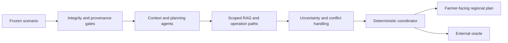

# Multi-Agent Smart Agriculture Decision System

> **A RAG-Grounded Multi-Agent Framework for Multimodal Decision Support in Precision Agriculture**

> **Guide-facing overview:** a provenance-constrained, conflict-aware,
> public-data-only system for aligned regional agriculture decision support in
> India.

## 1. Project idea

This research project builds a smart-agriculture decision-support system that
does not merely combine weather, soil, satellite, market, and advisory data.
It first verifies that the evidence belongs to the same crop, location, season,
date, and intended decision scope.

The central problem is that a plausible answer can be unrealistic if it mixes
weather from one location, soil from another, a market quotation for another
crop, and an advisory from another season. The proposed Multi-Agent System
(MAS) prevents this by using a frozen, aligned Indian benchmark and by carrying
provenance and usage restrictions through every stage of reasoning.

The system provides three safe outputs:

1. a source-cited **regional seasonal operation plan**;
2. a **conditional official operation** when the crop, geography, season,
   source-time, and required condition all pass; or
3. a **context-only status** when the evidence cannot support an operation.

It deliberately does not claim to observe an individual farm. Therefore, it
does not issue unsupported irrigation-now instructions, exact farm N/P/K
doses, disease diagnoses, chemical-treatment orders, leaf-image predictions,
storage bookings, or sell/hold decisions.

## 2. Research question and contribution

### Research question

> Can a multi-agent agriculture system provide useful, source-cited regional
> planning support from aligned public Indian evidence while preserving
> provenance, rejecting mismatched evidence, and handling comparable conflicts
> without inventing farm-specific action?

### Main contributions

| Contribution | Value to the research |
| --- | --- |
| Aligned Indian benchmark | Prevents cross-crop, cross-location, cross-season, and cross-date evidence mixing. |
| Provenance-constrained MAS | Every claim retains its source, hash, scope, allowed use, and safety status. |
| Metadata-filtered RAG | Official documents are admitted before retrieval, not selected from unrestricted web text. |
| Source-scoped operation bindings | Official operations retain their actual crop, geography, date, source, and condition boundaries. |
| Regional operation plans | Every scenario gets useful calendar/nutrient/IPM planning context without fabricated field observations. |
| Conflict-aware coordinator | Comparable evidence is handled by source scope, time, provenance, and safety policy instead of model confidence. |
| External evaluation oracle | Structural groundedness and safety are evaluated independently of the coordinator. |

## 3. Study scope and data design

The frozen study covers six representative crops, five verified districts per
crop, and ten historical contexts per site:

```text
6 crops × 5 districts per crop × 10 source-gated contexts = 300 scenarios
```

| Crop group | Crop | Coverage |
| --- | --- | --- |
| Cereal | Rice | Punjab Kharif districts |
| Cereal | Wheat | Punjab Rabi districts |
| Cereal | Maize | Tamil Nadu Rabi districts |
| Pulse | Chickpea | Maharashtra Rabi districts |
| Oilseed | Soybean | Madhya Pradesh and Rajasthan Kharif districts |
| Horticulture | Tomato | Tamil Nadu Rabi districts |

Each final study site was admitted only after compatible public evidence was
found for district identity, a representative cropland cell, crop/season,
historical weather, static soil, satellite quality, same-crop market context,
and regional management material.

The project uses only free public or institutional sources, including
geoBoundaries, ESA WorldCover, NASA POWER, ISRIC SoilGrids, Sentinel-2 through
Microsoft Planetary Computer, Agmarknet, ICAR--CRIDA, agricultural
universities, ICAR institutes, MPKV, and PPQS/CIBRC. Exact provider links,
hashes, source restrictions, and canonical artifact locations are in
[DATA_SOURCES.md](../DATA_SOURCES.md).

## 4. Evidence enrichments

The original registry and scenarios are enhanced through four additive,
source-linked layers. None creates synthetic weather, disease, market,
fertilizer, or crop-protection combinations.

| Enrichment | What it adds | Why it matters |
| --- | --- | --- |
| First | Historical weather/water, satellite, market context, regional management references, and a capability contract | Gives agents usable context while preserving abstention boundaries. |
| Second | Official RAG, source-quoted operations and bindings, advisory discovery, and NDVI chronology | Makes retrieval and operation use scenario-scoped. |
| Third | Regional calendar, nutrient, IPM, and condition-aware operation plan items | Gives all 300 scenarios a useful cited planning layer. |
| Fourth | Crop-scoped post-harvest handling plus static storage/infrastructure context | Extends planning realism without claiming live facility availability or logistics. |

The detailed collection and validation path is documented in
[Approach.md](../Approach.md). The source inventory is documented in
[DATA_SOURCES.md](../DATA_SOURCES.md).

## 5. RAG-grounded multi-agent architecture

The MAS begins only after the fail-closed loader has assembled one verified
scenario bundle. It then follows this evidence path:



The 21 roles are grouped as follows:

| Group | Purpose |
| --- | --- |
| Integrity and provenance gates | Verify scenario identity, crop/district/season alignment, metadata permissions, and source lineage before reasoning. |
| Context agents | Present only historical weather, static soil, representative-cell satellite, market, nutrient-policy, IPM, and vision-availability context. |
| Planning and retrieval agents | Produce regional calendar cards, retrieve only admitted official passages, preserve regulatory metadata, and emit condition-aware official operations. |
| Post-harvest agent | Provides crop-scoped handling cards and static local infrastructure context without claiming capacity, booking, or dispatch. |
| Safety and coordination roles | Preserve abstentions, detect comparable conflicts, apply deterministic provenance policy, and render citations. |
| Benchmark evaluator | Records the final trace for external evaluation; it never changes a farmer-facing decision. |

The full agent-by-agent input, output, usage, boundary, sequence, and module
reference is [AGENTS.md](../AGENTS.md). The reason for the architecture is in
[New Architecture Justification.md](<New Architecture Justification.md>).

## 6. Conflict awareness and farmer-facing behavior

The project does not call unrelated facts a conflict. It detects only
same-domain, target-aligned claims. The coordinator then:

1. gives source-scoped safety restrictions precedence;
2. excludes blocked, out-of-scope, abstained, and unavailable evidence;
3. ranks remaining claims by recorded scope, temporal validity, provenance,
   disposition, and quality; and
4. safely defers a true equal-precedence tie.

This policy is deterministic. An optional LLM cannot change a source, action,
condition, citation, gate, or conflict winner.

The farmer receives a concise source-cited regional plan. A message can present
a seasonal operation reference, regional nutrient/IPM context, a valid
conditional operation, post-harvest handling guidance, and historical market
context. Technical abstention details remain in the trace unless they are
needed to explain why an operation is conditional or unavailable.

## 7. Bounded local LLM use

The MAS can run completely deterministically (E0). In the accepted E1-v5
configuration, a local Qwen2.5 7B model running through Ollama/Apple Metal
acts only as a bounded selector for eight roles. It may choose or prioritize
already-admitted fact, passage, or plan-card identifiers. It cannot generate
new agricultural facts or override deterministic safety/provenance control.

No model weights were fine-tuned. Prompt and candidate packaging refinements
were developed on a separate source-derived development set and frozen before
the final held-out test. The final protocol, thresholds, and result boundary
are in [BOUNDED_LLM_V5_HELDOUT_PROTOCOL.md](../BOUNDED_LLM_V5_HELDOUT_PROTOCOL.md).

## 8. Evaluation strategy

The project does not have field-level outcome labels, so it does not claim
irrigation, fertilizer, disease, yield, or profit accuracy. Instead, it
evaluates what the frozen evidence can prove:

- scenario and source alignment;
- citation and retrieval-scope compliance;
- operation binding and required-condition fidelity;
- safe abstention and unsupported-action prevention;
- conflict-detection and deterministic-resolution traces;
- grounded plan coverage across crops and locations;
- bounded-LLM evidence-selection quality; and
- clean-checkout reproducibility.

The external Oracle has 20 checks and is intentionally separate from the MAS
coordinator. Controlled conflict and provenance/alignment fixture registries
test policy boundaries that valid normal scenarios cannot necessarily expose.

Evaluation policy: [EVALUATION_POLICY.md](../EVALUATION_POLICY.md).

Oracle details: [ORACLE_EVALUATION_GUIDE.md](../ORACLE_EVALUATION_GUIDE.md).

Experiment rationale: [EXPERIMENT_RUNS_GUIDE.md](../EXPERIMENT_RUNS_GUIDE.md).

## 9. Current evidence and defensible claim

The completed results include a full deterministic reference, controlled
architecture removals, fixture suites, an accepted bounded-LLM configuration,
and clean-checkout reproduction. The canonical numerical tables, figures,
metric formulas, and interpretation are in [RESULTS.md](../RESULTS.md).
The paper-ready tables, figures, six normal source-traceable cases, one
explicitly labelled evaluation-only fixture case, and their input/output
fingerprint manifest are in
[`results/v2_2-paper-artifacts`](../../results/v2_2-paper-artifacts/).
The current paper boundary is the 19 archives named in
[`OFFICIAL_V2_2_RELEASE_MANIFEST.json`](../../results/v2_2-paper-artifacts/OFFICIAL_V2_2_RELEASE_MANIFEST.json);
earlier outputs remain recoverable historical records and are not mixed into
the reported results.

The current paper can claim:

> On a frozen public-data India benchmark, the proposed MAS produces
> source-scoped regional operation plans, preserves provenance and safety
> boundaries, performs controlled conflict coordination, and supports bounded
> local evidence selection across 300 aligned scenarios.

It cannot claim farm-specific recommendation accuracy, real-world agronomic
effectiveness, yield improvement, profit improvement, or farmer adoption.

## 10. Documentation navigation

- [Documentation map](../README.md)
- [Technical methodology](../Approach.md)
- [Architecture rationale](<New Architecture Justification.md>)
- [Agent reference](../AGENTS.md)
- [Data sources](../DATA_SOURCES.md)
- [Results](../RESULTS.md)
- [Paper artifacts](../../results/v2_2-paper-artifacts/)
- [Active paper-preparation work](../To-Do.md)
