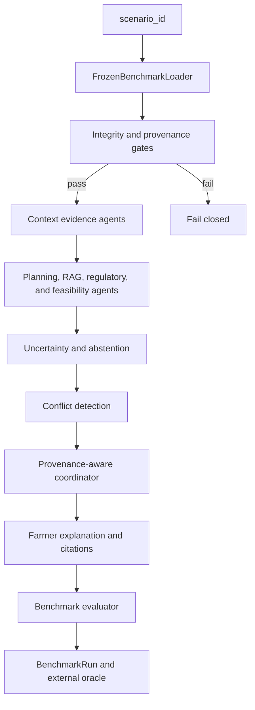

# Multi-Agent Smart Agriculture Decision System

> **Architecture Justification: a provenance-constrained, conflict-aware MAS
> for source-scoped regional agriculture planning**

## 1. Architectural purpose

The architecture is designed for a specific research problem: how to combine
public agricultural evidence without silently mixing crops, places, seasons,
dates, source purposes, or levels of decision authority.

The design therefore does not treat a language model as the primary decision
maker. It makes the evidence boundary explicit first, uses small agents with
narrow responsibilities, records typed provenance claims, and applies a
deterministic coordinator policy before rendering a farmer-facing plan.

The architecture supports regional planning from frozen public evidence. It
does not convert district or representative-cell context into an observed farm
condition or farm-specific prescription.

## 2. Design principles

1. **Alignment before reasoning.** Crop, location, season, date, representative
   site, source scope, and artifact hash must align before an agent sees data.
2. **Evidence before language.** A model may rank already-admitted evidence;
   it cannot invent a claim, citation, condition, or action.
3. **Separation of concerns.** Each role owns a constrained evidence domain so
   a weather, soil, RAG, regulatory, or coordinator error is auditable.
4. **Fail closed.** An identity, scope, binding, or hash mismatch halts the
   benchmark path instead of being repaired by inference.
5. **Regional guidance is not farm observation.** Field prescriptions require
   field evidence absent from the frozen benchmark.
6. **Comparable conflicts require explicit policy.** The coordinator considers
   only same-domain, target-aligned claims and resolves them through recorded
   provenance/safety rules rather than confidence alone.
7. **Evaluation is external.** The oracle observes completed traces and cannot
   alter an agent claim, coordinator decision, or farmer-facing message.

## 3. System architecture

The workflow begins from a frozen `scenario_id`, never a caller-supplied live
weather dictionary, field image, soil test, or recommendation object. The
loader joins only canonical registry, scenario, enrichment, plan, RAG-scope,
operation-binding, post-harvest, and capability-contract records.

## 4. Frozen loader and typed claims

### FrozenBenchmarkLoader

The loader is the architecture's main control point. It verifies scenario
identity, crop, state, district, season, date, site, canonical-row coverage,
source hashes, plan relationships, operation bindings, RAG permissions, and
post-harvest references before producing one immutable scenario bundle.

This prevents an agent from selecting an apparently relevant but mismatched
document or feature row. It also means every normal run is reproducible from
the same frozen input boundary.

### TypedEvidenceClaim

Every agent returns typed claims containing a stable claim ID, scenario ID,
agent name, decision domain, disposition, allowed use, source/citation,
spatial and temporal scope, quality, gate result, and a machine-readable
restriction or block reason where required.

Typed claims are necessary because prose alone cannot reliably answer:

- Which source supports this statement?
- Is it regional context, a conditional operation, or unavailable evidence?
- Does it apply to this crop, district, season, and decision date?
- Can it influence the final farmer message?

## 5. Why the architecture uses 21 agents

The agents are intentionally small and evidence-scoped. Their value is not
that they simulate 21 independent advisers; it is that each one makes a
specific evidence or safety responsibility inspectable.

| # | Agent | Why it exists and how it is used | It must not do |
| ---: | --- | --- | --- |
| 1 | Scenario Evidence Router | Starts a run only from one frozen scenario and rejects caller-supplied live evidence. | Merge arbitrary farm inputs into the benchmark. |
| 2 | Crop--District--Season Alignment Validator | Verifies that linked crop, place, season, date, and site records describe one scenario. | Repair a mismatch by guessing. |
| 3 | Metadata Gate | Gives later roles the capability contract and evidence-use limits. | Grant new permissions. |
| 4 | Evidence Provenance | Carries source identity, URL, hash, raw path, and locator into the trace. | Refresh or replace sources at runtime. |
| 5 | Weather Context | Supplies historical weather/water context around the decision period. | Forecast or order irrigation. |
| 6 | Soil Context | Supplies static SoilGrids background properties. | Treat gridded properties as a farm soil test. |
| 7 | Satellite/NDVI Context | Supplies quality-gated representative-cell trend context. | Infer crop identity, field status, disease, or stage. |
| 8 | Market Evidence | Supplies historical nearest-mandi comparison context. | Forecast prices or order sell/hold. |
| 9 | Fertilizer Baseline | Preserves regional nutrient-policy material and the field-dose boundary. | Calculate a personalized dose. |
| 10 | Crop-Protection Safety | Preserves IPM/regulatory guardrails. | Diagnose disease or authorize treatment. |
| 11 | Vision Availability | Makes the lack of an aligned field image explicit. | Produce a leaf-disease prediction. |
| 12 | Regional Calendar / Operation Window | Exposes seasonal calendar and plan timing context. | Claim observed farm stage. |
| 13 | Official Operations RAG | Ranks only metadata-admitted official passages. | Retrieve out-of-scope material or create facts. |
| 14 | Post-Harvest Storage & Logistics | Produces crop-scoped handling cards and static local infrastructure context. | Assert readiness, capacity, booking, dispatch, freight, or sell/hold. |
| 15 | Regulatory Compliance | Preserves PPQS/CIBRC regulatory metadata for audit. | Authorize a chemical application. |
| 16 | Action Feasibility | Converts a scope-passed official operation into a conditional/blocked claim with its source condition. | Remove an unobserved condition. |
| 17 | Uncertainty / Abstention | Consolidates all restrictions and missing-evidence reasons. | Turn uncertainty into an action. |
| 18 | Conflict Detection | Finds only same-domain, target-aligned conflicts or eligible natural divergences. | Invent conflict from unrelated context. |
| 19 | Provenance-Aware Coordinator | Resolves admissible conflicts, ranks plan cards, and records accepted/rejected/deferred evidence. | Let an LLM override scope, safety, or field gates. |
| 20 | Farmer Explanation / Citation | Renders the approved plan into concise source-cited farmer language. | Add uncited action or unsupported advice. |
| 21 | Benchmark Evaluator | Persists trace properties for independent evaluation. | Alter the decision it measures. |

The full input/output contract, module path, execution order, and handoff graph
remain in [AGENTS.md](../AGENTS.md). That document is the canonical interface
reference; this document explains why the roles are architecturally necessary.

## 6. Controlled RAG and operation paths

The architecture has three separate retrieval paths because their admissibility
rules differ:

1. **Generic official RAG.** The 92-document corpus is filtered by crop,
   geography, source time, source role, and scenario identity before ranking.
2. **Recovered official operation path.** PAU/MPKV operation passages remain
   outside generic RAG and become retrievable only after their scenario action
   binding passes crop, geography, season, and time gates.
3. **Exact-crop post-harvest path.** Crop-handling passages are exposed only
   after exact-crop scope passes; directory records remain context, not RAG
   operational instructions.

This separation is necessary to prevent a source-valid document from becoming
scenario-valid merely because it is semantically similar to the question.

## 7. Regional plans, feasibility, and safety boundary

The regional-operation-plan layer converts official calendar, nutrient, IPM,
and valid operation material into source-linked scenario plan items. It makes
the system useful across all 300 scenarios without claiming that it knows a
farm's current state.

Action Feasibility is the only role that can create a conditional operation.
It preserves the official quote, scope, source locator, and required field
condition. If that condition is not observed, the output remains conditional;
it never becomes a direct farm action.

The same boundary applies to post-harvest material. The system can state a
source-scoped drying, handling, or storage prerequisite, but cannot state that
a particular lot is ready, a facility has capacity, or transport is available.

## 8. Deterministic conflict coordination

Conflict awareness is not a vote among agents. For an eligible same-domain,
target-aligned conflict, the coordinator applies this fixed sequence:

1. source-scoped opposing safety restrictions take precedence;
2. blocked, unavailable, abstained, and out-of-gate claims are excluded;
3. remaining evidence is ranked by gate status, geographical specificity,
   temporal specificity, provenance, disposition, and quality; and
4. an equal-precedence tie is safely deferred rather than guessed.

The trace records accepted, rejected, downgraded, and deferred claim IDs.
Natural NDVI--weather divergences remain contextual; they cannot create a
farm action. The stored fixture registry separately exercises all resolver
policy branches without turning a hypothetical overlay into farm evidence.

## 9. Bounded-LLM design

E0 runs the complete system deterministically. In E1-v5, eight roles may make
one bounded local-LLM selection after candidate evidence has passed all
deterministic admission checks. The LLM may select or prioritize supplied IDs;
it cannot create prose facts, alter source/citation/condition fields, bypass
gates, issue an action, or resolve a conflict.

The project refined prompts and candidate packaging, not model weights. The
development path and final held-out boundary are separate so that final
selection-quality metrics are not tuned on their own test data. See
[BOUNDED_LLM_V5_SELECTION_CONTRACT.md](../BOUNDED_LLM_V5_SELECTION_CONTRACT.md)
and [BOUNDED_LLM_V5_HELDOUT_PROTOCOL.md](../BOUNDED_LLM_V5_HELDOUT_PROTOCOL.md).

## 10. Evaluation architecture

The external oracle evaluates a completed trace against frozen source-derived
requirements. It checks lineage, claim identity, citation and RAG scope,
operation/binding/condition fidelity, plan coverage, restrictions, agent
permissions, conflict closure, vision availability, and bounded-LLM trace
validity. It is deliberately not a 22nd recommendation agent.

Two fixture suites complement normal scenarios:

- conflict fixtures test deterministic source/scope/time/safety resolution;
- provenance/alignment fixtures test that malformed linked evidence is blocked
  before it can influence a decision.

The policy, implementation details, formulas, figures, and completed results
are maintained separately to avoid competing versions of those records:

- [EVALUATION_POLICY.md](../EVALUATION_POLICY.md) — allowed claims and metric interpretation;
- [ORACLE_EVALUATION_GUIDE.md](../ORACLE_EVALUATION_GUIDE.md) — checks, schemas, and fixtures;
- [EXPERIMENT_PROTOCOL.md](../EXPERIMENT_PROTOCOL.md) — hash-locked experiment boundary;
- [EXPERIMENT_RUNS_GUIDE.md](../EXPERIMENT_RUNS_GUIDE.md) — rationale for E0--E3 and A0--A6; and
- [RESULTS.md](../RESULTS.md) — canonical numerical results and figures.

## 11. Architectural limits and future extension

The present architecture is intentionally limited by the evidence available:

- weather is historical context, not a decision-time forecast;
- soil is static gridded context, not a field test;
- satellite/NDVI is representative-cell context, not parcel observation;
- market material is historical context, not a price forecast;
- nutrient and crop-protection material is regional policy, not a personalized
  prescription; and
- no aligned leaf image exists, so the vision role returns `no_data`.

Future integration of field moisture, soil tests, observed stage, diagnosis or
threshold events, aligned images, and live logistics data must enter through
the same loader, provenance, scope, capability, and evaluation controls.

## 12. Documentation navigation

- [Documentation map](../README.md)
- [Guide-facing project overview](<Current Project Idea.md>)
- [Technical methodology](../Approach.md)
- [Agent interfaces](../AGENTS.md)
- [Source register](../DATA_SOURCES.md)
- [Results](../RESULTS.md)
- [Official v2.2 results index](../../results/README.md)
