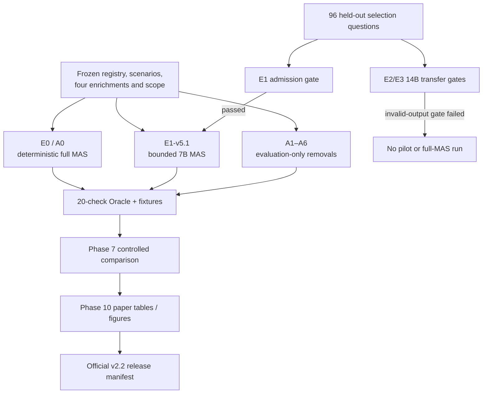

# Experiment Configurations and Result Archives

This document is the canonical decoder for the experiment identifiers and
official result directories used by the **Multi-Agent Smart Agriculture
Decision System – A RAG-Grounded Multi-Agent Framework for Multimodal Decision
Support in Precision Agriculture**.

It answers four practical questions:

1. What exactly does an `E*` or `A*` identifier change?
2. Which research question does that run answer?
3. Which files contain its evidence and what does each file mean?
4. What can—and cannot—be concluded from the result?

Only the 19 `v2_2-*` archives listed in
[OFFICIAL_V2_2_RELEASE_MANIFEST.json](../results/v2_2-paper-artifacts/OFFICIAL_V2_2_RELEASE_MANIFEST.json)
are official paper evidence. The [results index](../results/README.md) marks
the dated archive as historical. Never mix a pre-v2.2 value with a current
paper table, figure, or claim.

## 1. Identifier grammar and experiment families

| Prefix | Meaning | What changes | What remains fixed |
| --- | --- | --- | --- |
| `E` | **Execution / model-runtime configuration** | Whether an LLM is used, and which local model/runtime is admitted. | The 300 scenarios, frozen sources, enrichments, agent permissions, RAG scope, operation bindings, safety policy, and Oracle. |
| `A` | **Architecture baseline or ablation** | One declared MAS capability is removed for evaluation. | The same 300 scenarios and all still-admissible evidence. A-runs are evaluation-only, never farmer-facing. |
| `v2_2` | **Official release generation** | The detailed farmer renderer and Oracle v1.4 release boundary. | The frozen source data and scenario population. |

`E0` and `A0` are the same complete deterministic system viewed from two
different angles:

- **E0** says *how it executes*: no LLM call.
- **A0** says *which architecture executes*: the full 21-agent MAS.

There is therefore one official E0/A0 archive, not two competing results.

## 2. Shared evidence contract

Every accepted normal-scenario comparison uses the same 300 frozen records:
six crops, 30 verified crop–district–season sites, five states, 23 districts,
four enrichments, the 92-document scoped official RAG corpus, source-scoped
operation passages, regional operation-plan items, and post-harvest context.

The loader rejects mismatched crop, district, season, date, source scope,
canonical linkage, or raw-source hash before an agent receives evidence. No
run is evaluated against field outcomes. Thus terms such as *pass*, *precision*,
and *recall* in this document always refer to the frozen source/evidence
contract or selected fact IDs—not irrigation, dose, disease, yield, profit, or
farmer-outcome accuracy.

## 3. E-runs: execution, model, and runtime configurations

### E0 — deterministic full-MAS reference

| Item | Meaning |
| --- | --- |
| Official archive | [`results/v2_2-e0-full-mas`](../results/v2_2-e0-full-mas/) |
| System | A0: full 21-agent provenance-constrained MAS. |
| LLM | None; zero model calls. |
| Purpose | Establish the reproducible reference trace and show that the complete MAS preserves the frozen evidence/safety contract. |
| Result | 300/300 normal scenarios pass all 20 Oracle checks; zero direct farm actions; 60/60 conflict fixtures follow policy. |
| What it gives | A deterministic source-grounded reference for E1 and for every A1–A6 component-removal comparison. |
| What it does not give | Agricultural, field-action, irrigation, fertilizer, disease, yield, or profit accuracy. |

E0 is expected to obtain complete structural conformance because all normal
scenarios were frozen only after their source, identity, scope, and hash gates
passed, and E0 retains every required gate. The 100% number means
`300 traces passing all 20 checks / 300 traces`; it is not a claim that real
agriculture is 100% predictable.

### E1-v5.1 — accepted bounded-LLM full MAS

| Item | Meaning |
| --- | --- |
| Official full archive | [`results/v2_2-e1-v5-full-mas`](../results/v2_2-e1-v5-full-mas/) |
| Pilot archive | [`results/v2_2-e1-v5-30site-pilot`](../results/v2_2-e1-v5-30site-pilot/) |
| Hardware preflight | [`results/v2_2-e1-v5-apple-gpu-preflight`](../results/v2_2-e1-v5-apple-gpu-preflight/) |
| Held-out selector result | [`results/e1-v5-heldout-final`](../results/e1-v5-heldout-final/) — retained active support input, not a second 300-scenario result generation. |
| Model/runtime | Ollama with Apple Metal; `qwen2.5:7b-instruct`, bound Q4_K_M artifact; temperature 0.0. |
| LLM authority | Eight roles may select/order supplied immutable evidence IDs only. Deterministic code retains evidence, citation, condition, safety, operation, and conflict authority. |
| Purpose | Test whether bounded local LLM selection/presentation works reliably without weakening the deterministic MAS boundary. |
| Full-MAS result | 300/300 structural passes, 2,400 accepted bounded selections, zero invalid/fallback events in the full batch, and zero direct farm actions. |

The one-time 96-question held-out test measures model selection quality, not
the 300-scenario Oracle. Its fact precision and recall are both `71/72 =
98.6%`; named RAG-passage selection is `12/12`; safe-empty behavior is
`30/30`; and invalid/fallback counts are `0/96`. The 30-site pilot verifies
the model-enabled end-to-end path before the full batch. The Metal preflight
verifies 4,638,040,390 GPU-resident bytes for the bound model artifact; PyTorch
MPS availability is not treated as evidence of Ollama acceleration.

### E2 — Ollama 14B transfer gate

| Item | Meaning |
| --- | --- |
| Preflight archive | [`results/v2_2-e2-apple-gpu-preflight`](../results/v2_2-e2-apple-gpu-preflight/) |
| Relevance archive | [`results/v2_2-e2-v5-relevance-14b`](../results/v2_2-e2-v5-relevance-14b/) |
| Summary archive | [`results/v2_2-phase8-e2-e3-relevance-transfer`](../results/v2_2-phase8-e2-e3-relevance-transfer/) |
| Model/runtime | Ollama/Metal, Qwen2.5 14B GGUF Q4_K_M. |
| Purpose | Check whether a larger 14B deployment meets the same frozen v5.1 structured-selection admission criteria as E1. |
| Result | Apple GPU preflight passed, but 9/96 responses were invalid structured output (9.375%), exceeding the pre-registered maximum of 2%. |
| Consequence | Not admitted to a 30-site pilot or a 300-scenario full-MAS run. |

This is a transparent **negative deployment-admission result**. It does not
mean that the 14B model is unsafe in all uses or worse at agriculture. It means
that under this exact bounded JSON contract it could not satisfy the required
structured-output reliability gate.

### E3 — MLX-LM 14B transfer gate

| Item | Meaning |
| --- | --- |
| Preflight archive | [`results/v2_2-e3-apple-gpu-preflight`](../results/v2_2-e3-apple-gpu-preflight/) |
| Relevance archive | [`results/v2_2-e3-v5-relevance-14b-mlx`](../results/v2_2-e3-v5-relevance-14b-mlx/) |
| Summary archive | [`results/v2_2-phase8-e2-e3-relevance-transfer`](../results/v2_2-phase8-e2-e3-relevance-transfer/) |
| Model/runtime | MLX-LM with Apple GPU, Qwen2.5 14B Instruct MLX 4-bit artifact. |
| Purpose | Evaluate a second local Apple-GPU deployment of the same 14B model family under the same frozen relevance-transfer task. |
| Result | Apple GPU preflight passed, but 24/96 responses were invalid structured output (25.0%), above the 2% limit. |
| Consequence | Not admitted to a pilot or full-MAS run. |

E2 and E3 use the same model family but different GGUF/MLX quantized artifacts.
Their result is therefore a deployment-backend transfer observation, **not** a
pure Ollama-versus-MLX runtime comparison.

## 4. A-runs: architecture reference and component removals

All A-runs use the normal 300-scenario population and the same 20-check Oracle.
The reported all-check rate is `scenarios passing every Oracle check / 300`.
A lower value identifies a deliberately missing contract property; it is not a
measurement of farmer harm, crop loss, or agricultural effectiveness.

| ID | Official archive | System change | Result | What the result gives |
| --- | --- | --- | ---: | --- |
| **A0** | `results/v2_2-e0-full-mas/` | Nothing removed; identical to E0 execution. | 300/300 | Reference showing the full MAS preserves all required evidence, plan, citation, safety, and conflict-trace properties. |
| **A1** | [`results/v2_2-a1-regional-plan-only`](../results/v2_2-a1-regional-plan-only/) | Keeps only direct regional plan rendering; removes the coordinated MAS path. | 0/300 | Calendar/nutrient/IPM references alone do not constitute a complete source-scoped operation and decision trace. |
| **A2** | [`results/v2_2-a2-centralized-rag`](../results/v2_2-a2-centralized-rag/) | Uses one centralized scoped-RAG baseline; no typed multi-agent plan path. | 0/300 | Retrieval alone cannot replace scenario plan binding, typed claims, feasibility, and coordination. |
| **A3** | [`results/v2_2-a3-no-scoped-rag`](../results/v2_2-a3-no-scoped-rag/) | Withholds generic/source-scoped operation and post-harvest retrieval passages. | 71/300 | 229 traces lose complete conditional-operation/citation coverage, quantifying the structural contribution of scoped recovery. |
| **A4** | [`results/v2_2-a4-no-regional-plans`](../results/v2_2-a4-no-regional-plans/) | Withholds regional plan summaries/items, operation records/bindings/passages, and dependent nutrient/IPM roles. | 0/300 | The third enrichment is required for complete grounded-plan coverage. |
| **A5** | [`results/v2_2-a5-no-provenance-gates`](../results/v2_2-a5-no-provenance-gates/) | Removes the declared downstream provenance/alignment validator. | 300/300 normal | Valid normal inputs do not contain an alignment fault; the separate malformed fixture suite measures the omitted gate's protective value. |
| **A6** | [`results/v2_2-a6-conflict-ablation`](../results/v2_2-a6-conflict-ablation/) | Detects conflicts but withholds them from the coordinator. | 257/300 | The 43 natural contextual NDVI–weather divergences lose the required coordinator-resolution trace, demonstrating the coordinator's role beyond detection. |

### Reading the apparently counterintuitive A5 result

A5's `300/300` is not an argument that provenance/alignment gates are
unnecessary. The normal scenarios are valid by construction. The controlled
provenance fixture archive
[`results/v2_2-provenance-gate-fixtures`](../results/v2_2-provenance-gate-fixtures/)
supplies the causal test: A0 blocks 50/50 mismatched identity/binding cases,
while A5 exposes the same 50 cases at its deliberately omitted validator
boundary. The shared loader still blocks all 10 raw-payload hash mutations in
both configurations.

### Reading the A6 result

The 43 A6 non-passes are not wrong farm recommendations. They are natural,
non-actionable NDVI–weather context divergences that require a provenance-aware
coordinator trace in A0. A6 deliberately suppresses that resolution step;
safety and direct-action prevention remain intact. The separate 60 conflict
fixtures demonstrate the policy more directly: A0 resolves 60/60 expected
cases; A6 still detects 48/48 eligible cases but resolves 0/48 by design.

## 5. What files inside a run archive mean

The first-level file names below occur in full-batch archives unless noted.
They are evidence records, not all independent performance metrics.

| File or folder | Meaning and how to use it |
| --- | --- |
| `run_manifest.json` | Immutable run identity: configuration/system IDs, Git state, scenario and source hashes, prompt/model/hardware metadata, run controls, and output counts. Start here to establish whether two results are comparable. |
| `batch_summary.json` | Human-readable aggregate counts: scenarios, structural outcomes, direct actions, bounded calls, fallback/invalid events, latency, and memory. It is a summary, not a substitute for individual traces. |
| `aggregate_oracle_result.json` | Per-check rates across all normal scenarios. It has 20 independent check rows plus one derived `overall_structural_pass` row. Use it for structural-contract percentages. |
| `scenarios/<scenario_id>.json` | One persisted `BenchmarkRun`: joined scenario identity, claims, selected RAG passages, plan/operation handling, citations, conflicts, final decision, detailed farmer message, Oracle result, and trace telemetry. Use for audit or case study; do not treat a single trace as population evidence. |
| `progress.json` | Completion/progress bookkeeping. It supports execution audit but does not measure model or agricultural quality. |
| `conflict_fixture_runs.json` | Present in E0/A6 fixture-enabled archives. Contains the 60 labelled counterfactual policy traces. These are not historical farm scenarios. |
| `fixture_oracle_result.json` | E0 fixture aggregate: pass/fail against declared conflict-policy expectations. |
| `conflict_ablation_result.json` | A6-only fixture summary separating eligible conflict detection from coordinator resolution withheld by design. |
| `provenance_fixture_result.json` and `provenance_fixture_oracle_result.json` | The 60 malformed identity/scope/hash fixture outcomes and independent expected-behavior evaluation. They demonstrate evidence-gate protection, not agriculture. |

An E1 full archive has the same normal trace structure as E0 plus bounded LLM
selection metadata inside each scenario trace. The model may influence only
selection/order of admitted IDs. E1’s source citations, operations, direct
action status, and conflict resolution remain deterministic.

## 6. Held-out, preflight, transfer, comparison, and release files

| Path / file | What it contains | What it gives the research |
| --- | --- | --- |
| `results/e1-v5-heldout-final/run_manifest.json` | One-time final selection-evaluation identity, hashes, model/backend settings, and question-set binding. | Establishes that the reported 96-question relevance result used the frozen held-out boundary. |
| `results/e1-v5-heldout-final/aggregate_final_heldout_metrics.json` | Precision, recall, safe-empty, named-passage, exact plan/operation, invalid, fallback, and latency aggregates. | The authoritative source of E1-v5.1 model-selection metrics and their denominators. |
| `results/e1-v5-heldout-final/final_acceptance_report.json` | Pre-registered thresholds and pass/fail decision. | Shows whether E1 was allowed to proceed to pilot/full MAS; it is not an agricultural evaluation. |
| `results/e1-v5-heldout-final/per_question/*.json` | Expected IDs, candidate IDs, selected IDs, conditions, output status, and latency for each of 96 questions. | Enables exact TP/FP/FN and safe-empty audit. |
| `v2_2-e1-v5-apple-gpu-preflight/acceleration_evidence.json` | Bound 7B artifact identity, Ollama/Metal probe, GPU-resident bytes, and host details. | Verifies actual local GPU residency for E1; it is not a quality score. |
| `v2_2-e2-*/` and `v2_2-e3-*/` `acceptance_report.json` / `aggregate_relevance_metrics.json` | 14B transfer gate metrics and structured-output validity decision. | Transparently explains why neither E2 nor E3 was scaled to pilot/full MAS. |
| `v2_2-phase7-controlled-comparison/phase7_comparison_manifest.json` | Shared-input/hash parity for E0, E1, A1–A6, and fixtures. | Supports fair controlled comparison rather than subjective answer comparison. |
| `v2_2-phase7-controlled-comparison/e0_e1_paired_trace_comparison.csv` | Scenario-wise E0/E1 identity, decision, operation, safety, and citation parity. | Shows bounded selection did not change deterministic decision authority. |
| `v2_2-phase7-controlled-comparison/architecture-ablation/oracle_metric_rates.csv` | Per-Oracle-check A0–A6 rate matrix. | Identifies the contract property removed by each ablation. |
| `v2_2-final-reproducibility-2026-10-12/README.md` | Clean-commit verifier inputs, comparisons, and exact-match results. | Documents 57/57 artifact checks, exact E0 trace matches, fixture matches, and refreshed Metal evidence. |
| `v2_2-paper-artifacts/TABLE_1_...` through `TABLE_10_...` and `FIGURE_1_...` through `FIGURE_4_...` | Publication-ready tables, figures, case studies, CSV companions, and hashes generated from persisted evidence. | Provides the material for the paper, without creating a new experimental result. |
| `v2_2-paper-artifacts/OFFICIAL_V2_2_RELEASE_MANIFEST.json` | Exact list and aggregate SHA-256 of the 19 official archives. | Defines the reproducible paper evidence boundary. |

## 7. How the result types fit together

The sequence prevents circular reasoning:

1. selection quality is tested separately before a model-enabled full run;
2. structural safety is tested downstream of every full trace;
3. controlled removals show what each architecture component contributes;
4. controlled fixtures test faults absent from valid normal inputs; and
5. paper artifacts only render stored results after all runs are frozen.

## 8. Where to read next

- [RESULTS.md](RESULTS.md) — current numerical outcomes, exact formulas, and
  numerator/denominator values.
- [EXPERIMENT_RUNS_GUIDE.md](EXPERIMENT_RUNS_GUIDE.md) — scientific rationale
  and valid interpretation of each comparison.
- [ORACLE_EVALUATION_GUIDE.md](ORACLE_EVALUATION_GUIDE.md) — all 20 Oracle
  checks and fixture evaluation behavior.
- [PHASE8_14B_EXPERIMENTS.md](PHASE8_14B_EXPERIMENTS.md) — detailed E2/E3
  transfer evidence and negative-result boundary.
- [FILES_INFORMATION.md](FILES_INFORMATION.md) — complete current-versus-legacy
  file inventory.
