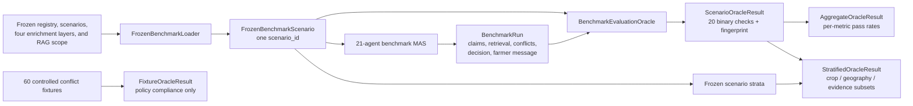

# Oracle Evaluation Guide and Audit Reference

## Purpose

`evaluation/benchmark_oracle.py` is the independent, read-only evaluator for
the current frozen benchmark MAS. It evaluates whether a completed
`BenchmarkRun` complied with the project’s immutable evidence, source scope,
operation, safety, abstention, conflict, and bounded-LLM rules.

It is **not** an agent, is not part of the LangGraph workflow, makes no LLM
call, and never changes a scenario, enrichment, source artifact, RAG corpus,
or farmer-facing message. It does not generate a farming recommendation or an
agricultural ground-truth label.

The paper-facing measurement boundary remains
[`EVALUATION_POLICY.md`](EVALUATION_POLICY.md).

## End-to-end evaluation flow



The oracle is deliberately **downstream** of the MAS. It has no authority to
change claims, retrieve another document, select an action, or rewrite the
farmer message. It only evaluates the completed trace against the same frozen
evidence bundle that was available to the agents.

## Evaluation inputs and admissible evidence

| Input | Produced by | How the oracle uses it |
| --- | --- | --- |
| `FrozenBenchmarkScenario` | `FrozenBenchmarkLoader` | Reconstructs the immutable identity, capability contract, plan items, source records, operation bindings, RAG allow-lists, NDVI--weather candidate status, and post-harvest records that a run is allowed to use. |
| `BenchmarkRun` | Benchmark LangGraph workflow | Examines emitted typed claims, retrieved passages, conflicts, coordinator decision, farmer message, and in-workflow evaluation trace. |
| 60 conflict fixtures | `ConflictFixtureRunner` | Separately checks deterministic coordinator policy on controlled, explicitly non-farm counterfactual cases. |

The evaluator never accepts raw user input, a live API response, an unscoped
RAG chunk, a model explanation, or a farmer assertion as an oracle label. This
is why its results are reproducible structural measurements rather than
claimed agricultural ground truth.

## Inputs and result schema

One normal evaluation takes only:

1. the immutable `FrozenBenchmarkScenario` loaded by
   [`FrozenBenchmarkLoader`](../data/benchmark_loader.py); and
2. the completed [`BenchmarkRun`](../graph/benchmark_workflow.py) for that
   same `scenario_id`.

It returns a JSON-serializable `ScenarioOracleResult`:

```text
ScenarioOracleResult
├── oracle_version
├── scenario_id
├── overall_passed
├── failing_check_names
├── structural_fingerprint
├── checks[]
│   ├── name
│   ├── passed
│   ├── expected
│   ├── observed
│   └── detail
└── metrics
```

Each named metric is binary per run. `AggregateOracleResult` later aggregates
the same named checks across the 300 normal scenarios or a baseline/ablation
run. `StratifiedOracleResult` reports the same checks separately by crop,
state, district, site, season, anchor/supplement partition,
conditional-operation availability, and natural-divergence status. This makes
comparisons paired and prevents a high aggregate rate from hiding a weak
source/evidence subset.

## Implemented structural checks

Each check is binary for one completed run: `1` for pass and `0` for fail.
The `overall_structural_pass` is `1` only when **all 20** checks pass.

| Oracle metric | Corresponding frozen evidence / trace field | Canonical expectation | What a failure means |
| --- | --- | --- | --- |
| `input_lineage_integrity` | Scenario ID on the run, decision, evaluator record, and every claim; source lineage fields | One scenario identity, unique claim IDs, and source lineage for sourced claims. | A trace mixes scenario identities, duplicates a claim, or loses source lineage. |
| `stable_claim_identity_fidelity` | Recomputed SHA-256 claim identity from every typed-claim payload | Each claim ID re-derives from its immutable evidence payload. | An evidence field changed after claim creation while retaining a stale identity. |
| `claim_scope_contract_compliance` | Claim spatial and temporal scope versus frozen district, state, and source-time semantics | Each claim names the frozen district/state, preserves a non-farm limit, and declares a bounded source-time scope. | An agent silently recast representative-cell evidence as another location or unbounded present-time farm evidence. |
| `citation_traceability` | Coordinator citations, emitted claim sources, retrieved-passage sources, and scenario source inventory | A decision citation is both present in the trace and recognised by the frozen scenario source inventory. | A citation was invented, swapped, or detached from scenario evidence. |
| `context_source_provenance_binding` | Weather, soil, satellite, market, fertilizer, crop-protection, and post-harvest context claims | Each context claim preserves its frozen source identity, allowed use, and stated non-farm boundary. | A contextual source is detached from provenance or recast as unsupported action authority. |
| `rag_scope_compliance` | Scenario-specific generic, source-scoped-operation, and exact-crop post-harvest RAG allow-lists | Every retrieved passage belongs to its admitted corpus layer and scenario allow-list. | Retrieval leaked across crop, geography, date, source role, or corpus layer. |
| `operation_binding_and_condition_compliance` | Official action bindings, regional plan items, post-harvest plan items, and emitted conditional claims | Conditional official and post-harvest operations match canonical plan/binding records and retain their missing condition. | A source, binding, quote, or required field/lot condition was lost or altered. |
| `conditional_operation_completeness` | Pre-admitted official-operation passages and exact-crop post-harvest plan items | Every pre-admitted conditional plan item is emitted exactly once. | A valid, scoped plan item silently disappeared, was duplicated, or an unadmitted item entered the trace. |
| `source_quote_locator_hash_fidelity` | Frozen operation record/plan item versus claim source ID, URL, SHA-256, locator, and source quote | Each operational claim preserves its frozen source ID, official URL, raw SHA-256, source locator, and quoted text. | A correct-looking operation was attached to a different source snapshot, page/section, URL, or quotation. |
| `grounded_plan_coverage` | Calendar, regional nutrient-policy, regional crop-protection policy, and plan-item IDs | Calendar, nutrient-policy, IPM-policy, plan IDs, and evidence trace are retained. | Valid source-linked planning structure was omitted. |
| `plan_and_selected_operation_citation_coverage` | Mandatory plan-item source IDs, selected conditional-operation source, and coordinator citations | All mandatory plan sources and the selected operation source remain in coordinator citations. | The final structured decision dropped a source required by a plan card or selected conditional operation. |
| `farmer_message_condition_and_citation_fidelity` | Rendered message, coordinator citations, selected conditional claim, and its documented condition | The message keeps only decision-trace IDs and renders the selected operation’s exact condition, source ID, and non-direct-action status. | The renderer hid or rewrote a required condition, source identity, or safety status. |
| `farmer_message_source_detail_and_facility_fidelity` | Rendered nutrient/IPM/RAG/facility cards against selected plan and source records | The message exposes source-recorded detail and facility context without inventing live availability, booking, or crop acceptance. | A source-backed detail was omitted, altered, or expanded into an unsupported logistics claim. |
| `unsupported_action_prevention_and_agent_permissions` | Capability contract, decision flag, agent identity, claim disposition, and direct-action metadata | The public-data benchmark issues no direct farm action; restricted context agents remain non-operational. | A context source was promoted to an unsupported action. |
| `abstention_reason_coverage` | Blocked/abstained/no-data claims and mandatory capability restrictions | Every unavailable claim has a reason and all capability-contract restrictions remain in the uncertainty trace. | Missing evidence was hidden, dropped, or converted into an implicit conclusion. |
| `conflict_trace_completeness_and_exclusion` | Detected conflicts, coordinator resolution records, conflicting claim IDs, final citations | Every detected conflict has a rule/rationale trace; rejected/deferred evidence cannot supply an exclusive final citation. | The coordinator did not audibly resolve/defer a conflict or leaked rejected evidence. |
| `conflict_resolution_citation_fidelity` | Each resolution's citations against source IDs carried by its own conflicting claims | A resolution cites only source IDs carried by its own conflicting claims, and those IDs remain in the decision trace. | The coordinator borrowed an unrelated citation to justify a conflict resolution. |
| `natural_ndvi_weather_divergence_policy` | Stored natural-signal candidate status, NDVI–weather conflict record, and resolution status | Only a stored eligible divergence creates one contextual, non-action conflict and resolution. | A real divergence was omitted, a non-eligible difference was forced into a conflict, or divergence was promoted to an action. |
| `vision_no_data_boundary` | Frozen `leaf_vision_agent` restriction and vision-availability claim | Exactly one vision claim remains `no_data`/unavailable/abstained with the frozen no-image reason. | The legacy vision model or an inferred diagnosis leaked into a scenario without an aligned field image. |
| `bounded_llm_trace_compliance` | `bounded_llm` metadata: approved agent, prompt SHA-256, selected fact IDs, and safety flag | Any bounded-LLM trace has an approved agent name, valid prompt hash, unique selected IDs, and a non-authoritative safety flag. | A selection trace is malformed or appears able to override deterministic safety. |

The oracle also provides a deterministic structural fingerprint for comparing
two runs of the same frozen scenario. It deliberately excludes runtime latency
from that fingerprint because timing is a separate efficiency metric.

## Derived reporting benchmarks

The executable oracle exposes three complementary result forms. They should
be reported separately, never merged into a fabricated agricultural-accuracy
number.

| Result form | What it measures | Current verified status |
| --- | --- | --- |
| Per-scenario oracle | Twenty source/policy/renderer checks for one completed MAS trace. | 300/300 normal traces pass every check. |
| Deterministic repeatability fingerprint | Whether two normal executions of the same frozen input retain the same observable trace. | Regression-tested on repeated normal runs. |
| Stratified oracle report | The same twenty checks disaggregated by crop, state, district, site, season, scenario partition, operation coverage, and divergence eligibility. | 72 frozen stratum rows across the 300 scenarios; no stratum is hidden inside the aggregate. |
| Controlled fixture oracle | Whether the conflict coordinator follows its documented policy under controlled counterfactual evidence. | 60/60 expected outcomes with required family coverage. |

These are evaluation parameters that substantiate provenance, scope,
condition-fidelity, safety, conflict-policy, and reproducibility claims. They
are not field-effectiveness labels.

## Aggregation, stratification, and comparative use

For a run set containing `N` scenarios, the pass rate for any oracle check is:

```text
metric pass rate = number of scenarios passing that check / N
overall structural pass rate = number of scenarios passing all 20 checks / N
```

The aggregate always retains the numerator and denominator, not only a rounded
percentage. This is important when a future baseline or ablation fails only a
small number of source scopes.

`aggregate_stratified()` applies the same computation without changing the
scenario population. It produces separate rows for these immutable dimensions:

| Dimension | Values are derived from | Why it is reported |
| --- | --- | --- |
| Crop | Canonical scenario manifest | Reveals crop-specific scope or operation failures. |
| State, district, site | Frozen registry and manifest | Reveals geography-specific retrieval or source-alignment failures. |
| Season | Canonical scenario manifest | Separates kharif and rabi evidence regimes. |
| Scenario partition | `ANCHOR_` or `SUPPLEMENT_` scenario ID prefix | Ensures anchor and supplementary historical contexts are not hidden in one rate. |
| Conditional-operation availability | Pre-admitted official-operation passages | Separates scenarios with and without a time-valid source-quoted operation. |
| Natural NDVI–weather divergence status | Frozen candidate registry | Separates the 43 eligible natural contextual-divergence cases from ordinary cases. |

Every full-MAS versus baseline/ablation comparison must run on the same 300
`scenario_id` values and be evaluated by this unchanged oracle. The persisted
A0–A6 report verifies those prerequisites by checking identical scenario IDs
and frozen-input hashes before aggregating the paired structural results. The
resulting per-scenario records permit paired comparisons of which contract each
alternative breaks. The oracle must not be modified to favor a baseline or an
ablation.

## Controlled conflict-fixture evaluation

`BenchmarkEvaluationOracle.evaluate_fixture_runs()` consumes results from
[`ConflictFixtureRunner`](../evaluation/conflict_fixture_runner.py). Its
`FixtureOracleResult` records fixture-family coverage, the number of expected
policy outcomes matched, and a result per controlled case.

The fixture oracle requires the full fixed registry:

| Fixture family | Required cases | Required behaviour |
| --- | ---: | --- |
| Coordinator-resolution policy | 48 | Apply source/scope/time/provenance precedence, safety precedence, or safe tie deferral. |
| Pre-resolution integrity rejection | 6 | Block before conflict detection and coordination. |
| Unrelated-domain negative control | 6 | Do not create a false conflict. |

These 60 records are explicitly labelled
`evaluation_only_counterfactual_not_real_farm_evidence`. They are controlled
policy tests, not agricultural observations, and are never included in a
normal 300-scenario run or a farmer message.

## Provenance/alignment integrity-fixture evaluation

The normal `BenchmarkEvaluationOracle` remains frozen at 20 checks for the
300 real scenarios. A separate
[`provenance_fixture_oracle.py`](../evaluation/provenance_fixture_oracle.py)
evaluates the paired A0/A5 integrity-boundary protocol in
[`data/provenance_fixture_registry`](../data/provenance_fixture_registry/).
Keeping it separate prevents an evaluation-only invalid-input test from
changing the normal scenario oracle after E0 has been recorded.

| Controlled fault | Cases | Required outcome |
| --- | ---: | --- |
| Plan-item crop mismatch | 10 | A0 blocks at the alignment validator; A5 reaches only its documented omitted-gate exposure boundary. |
| Plan-item district mismatch | 10 | Same A0/A5 boundary behaviour. |
| Plan-item season mismatch | 10 | Same A0/A5 boundary behaviour. |
| Plan-item decision-date mismatch | 10 | Same A0/A5 boundary behaviour. |
| Plan-item scenario-binding mismatch | 10 | Same A0/A5 boundary behaviour. |
| Weather payload SHA-256 mismatch | 10 | The shared frozen loader blocks both A0 and A5 before workflow gates. |

The fixture runner stops before any context agent, coordinator, or farmer
renderer executes. Thus its checks are **not** agronomic actions or farmer
outputs. The independent aggregate requires: exact 10-per-type coverage;
50 A0 alignment blocks; 50 A5 alignment-boundary exposures; 10 shared loader
hash blocks; and zero direct actions.

## Reproduction

Evaluate one completed normal run:

```bash
.venv-macos/bin/python - <<'PY'
from data.benchmark_loader import FrozenBenchmarkLoader
from evaluation.benchmark_oracle import BenchmarkEvaluationOracle
from graph.benchmark_workflow import BenchmarkMASWorkflow

scenario_id = "ANCHOR_PF_PB_LUDHIANA_RICE_KHARIF_20251130"
loader = FrozenBenchmarkLoader()
scenario = loader.load(scenario_id, verify_raw_hashes=False)
run = BenchmarkMASWorkflow(loader=loader).run(scenario_id, verify_raw_hashes=False)
result = BenchmarkEvaluationOracle().evaluate(scenario, run)
assert result.overall_passed
print(result.as_dict())
PY
```

Evaluate the controlled fixture protocol separately:

```bash
.venv-macos/bin/python - <<'PY'
from evaluation.benchmark_oracle import BenchmarkEvaluationOracle
from evaluation.conflict_fixture_runner import ConflictFixtureRunner

result = BenchmarkEvaluationOracle().evaluate_fixture_runs(
    ConflictFixtureRunner().run_all()
)
assert result.all_passed
print(result.as_dict())
PY
```

Evaluate the separate provenance/alignment integrity protocol:

```bash
.venv-macos/bin/python -m evaluation.provenance_fixture_runner \
  --output-dir results/local-provenance-gate-fixtures
```

It writes the paired runner output and the independent fixture-oracle result
to the requested directory.

Evaluate the complete 300-scenario MAS in memory and produce aggregate plus
stratified results:

```bash
.venv-macos/bin/python - <<'PY'
from data.benchmark_loader import FrozenBenchmarkLoader
from evaluation.benchmark_oracle import BenchmarkEvaluationOracle
from graph.benchmark_workflow import BenchmarkMASWorkflow

loader = FrozenBenchmarkLoader()
workflow = BenchmarkMASWorkflow(loader=loader)
oracle = BenchmarkEvaluationOracle()
pairs = []

for scenario_id in loader.scenario_ids():
    scenario = loader.load(scenario_id, verify_raw_hashes=False)
    run = workflow.run(scenario_id, verify_raw_hashes=False)
    pairs.append((scenario, oracle.evaluate(scenario, run)))

aggregate = oracle.aggregate(result for _, result in pairs)
stratified = oracle.aggregate_stratified(pairs)
assert aggregate.fully_passing_scenario_count == aggregate.scenario_count
print(aggregate.as_dict())
print(stratified.as_dict())
PY
```

The current command is an in-memory audit. The implemented
[`benchmark_batch_runner.py`](../evaluation/benchmark_batch_runner.py)
persists the exact `ScenarioOracleResult`, `AggregateOracleResult`, and
`StratifiedOracleResult` artifacts for reproducible paper tables.

## Current verification status

The oracle has been tested with known-good normal traces and deliberately
mutated bad traces that introduce an unknown citation, out-of-scope passage,
lost operation condition, dropped conditional plan item, altered source
quotation, hidden farmer-message condition/source, or direct action. The
post-archive release-hygiene validation passes **193/193 tests** (42.04
seconds), including Phase 10 paper-artifact generation coverage and optional
Phase 8 binding/preflight/transfer-runner checks. Historical
comparison/held-out tests now resolve their v2.2 or recoverable-archive
locations without changing any frozen Oracle, evidence, or result hash. The
protocol-version assertion remains aligned with the hash-locked `1.1` snapshot
without changing persisted Oracle results.

An in-memory self-consistency validation of the full deterministic MAS over
the 300 frozen scenarios produced:

| Result | Value |
| --- | ---: |
| Normal scenarios evaluated | 300 |
| Fully passing structural traces | 300/300 |
| Passing checks per metric | 300/300 for all twenty checks |
| Disaggregated structural audit rows | 72 across eight frozen stratification dimensions |
| Stored controlled fixture outcomes | 60/60 |

This is a verification of the implemented full MAS against its own frozen
source and policy contract. The official v2.2 E0 run, A1–A6 comparisons, and
fixture results are in
[`results/v2_2-phase7-controlled-comparison`](../results/v2_2-phase7-controlled-comparison/).
The final clean-checkout verification is in
[`results/v2_2-final-reproducibility-2026-10-12`](../results/v2_2-final-reproducibility-2026-10-12/).
They report source/provenance/safety conformance, not agricultural outcome
accuracy.

### Persisted A0–A6 structural comparison

Before calculating any rate, the comparison runner verifies that every saved
system run has the exact same 300 scenario IDs, frozen-input artifact hashes,
and oracle-metric schema as A0. The resulting all-checks pass counts are:

| System | Structural pass count | Interpretation boundary |
| --- | ---: | --- |
| A0 full MAS | 300/300 | Proposed farmer-facing reference. |
| A1 regional-plan-only | 0/300 | Evaluation-only removal of coordinated evidence handling. |
| A2 centralized RAG | 0/300 | Evaluation-only centralized-planner baseline. |
| A3 without scoped RAG | 71/300 | Shows the structural loss when source-scoped recovery is removed. |
| A4 without regional plans | 0/300 | Evaluation-only third-enrichment ablation. |
| A5 without alignment gates | 300/300 | Valid frozen records do not exercise a malformed-input gate; use the separate integrity fixtures. |
| A6 without conflict coordinator | 257/300 | The 43 stored natural NDVI–weather divergence traces lose required coordinator handling. |

The 60 conflict-policy and 60 provenance/alignment fixture outcomes are
reported separately in the same result directory. No row above is an
agricultural accuracy measure or a claim that an ablation is safe for
farmer-facing use.

## How to interpret a pass or failure

- A **pass** means the completed trace conforms to the particular frozen
  evidence and safety contract being checked. It does not mean that the
  operation would succeed on a real farm.
- A **failure** names the exact check, expected invariant, observed value, and
  detail in `ScenarioOracleResult.checks`. The run should be treated as
  non-compliant and investigated before it contributes to a comparative
  result.
- A **300/300 pass rate** means all 300 normal traces conformed to all 20
  implemented structural checks in the audited deterministic configuration.
  It does not mean “100% agricultural accuracy.”
- A **300/300 A0 result is expected under this protocol**: each normal input
  was frozen only after source/identity/scope/hash admission, A0 retains all
  required components, and E0 makes no LLM call. The result would become a
  failure if a trace dropped a required condition, used an out-of-scope
  passage, lost citation/lineage, emitted an unsupported action, or omitted a
  required conflict/abstention record.
- The oracle is **externally separated from the runtime graph**, but not an
  independent farm-label source. It reads the same frozen evidence contract
  after the decision is complete and cannot modify it. Known-bad trace tests,
  ablations, and malformed-bundle fixtures establish that the evaluator can
  discriminate non-compliant behavior; they do not turn its score into an
  agronomic outcome measurement.
- A5's normal 300/300 result is not proof that alignment gates add no value:
  the normal population is valid by construction. The paired invalid-bundle
  protocol is the relevant test—A0 blocks 50/50 alignment mutations while A5
  reaches its documented omitted-gate exposure boundary.
- A **60/60 fixture result** means all fixed counterfactual policy cases met
  their expected resolver behavior. It is evidence of conflict-policy
  correctness, not a record of 60 farms.
- The **A6 fixture ablation** reports two deliberately separate quantities:
  expected ablation behavior (detection and safety remain intact) and A0
  resolver-policy compliance (which should fall for the 48 fixtures requiring
  coordinator resolution). The completed A6 run detected 48/48, resolved
  0/48, and issued zero direct actions. It is not an agricultural outcome
  score.
- The **A1 and A2 0/300 results** do not say that they return no text or that
  their retrieved evidence is invalid. A1 still has 300/300 regional-plan
  presence and A2 still has 300/300 RAG-scope compliance; each deliberately
  lacks other required full-MAS properties, so no scenario satisfies all 20
  checks.
- The **A3 71/300 result** isolates the contribution of scoped
  operation-recovery passages: the 229 remaining traces lack the required
  conditional-operation pathway when those passages are withheld. The
  **A4 0/300 result** isolates the regional-plan enrichment: its removal
  eliminates complete grounded-plan and plan-citation coverage even though
  some non-plan evidence remains.
- Crop and district rates are structural-coverage strata. In particular, the
  variation in A3 by crop maps where the removed recovered-operation evidence
  occurs in this frozen corpus; it is not a crop-performance, yield, or farmer
  benefit ranking. The detailed configuration and fixture interpretation is
  in [`RESULTS.md`](RESULTS.md#official-300-scenario-outcomes).

## Claims this oracle does not support

The oracle must not be used to report field-action accuracy, irrigation
accuracy, fertilizer-dose accuracy, pesticide effectiveness, disease-diagnosis
accuracy, yield improvement, farmer satisfaction, Brier score, or calibration.
Those require independent field outcomes, expert labels, or prospective data
that are intentionally outside the current benchmark.

## Relation to the bounded-LLM relevance benchmark

The structural oracle and bounded-LLM relevance evaluations have different
purposes. The oracle evaluates a completed MAS trace against 20 frozen
source/provenance/safety/renderer checks. Relevance evaluation measures the
ranking of immutable candidate IDs before they can affect presentation order.
The observed E1-v4 relevance result is retained as a baseline; the final
v5.1 quality measurement is the separate, hash-checked 96-question held-out
set. It contains 12 questions per bounded role, 30 safe-empty cases, and 12
exact named source-scoped operation/condition retrieval cases, with no overlap
with v4 or v5 development contexts/sites. Neither relevance set has
farm-outcome labels or can make the structural oracle an agricultural-accuracy
metric. See
[`BOUNDED_LLM_V5_HELDOUT_PROTOCOL.md`](BOUNDED_LLM_V5_HELDOUT_PROTOCOL.md).

## Completed E1-v5 Phase 7 evaluation

The external oracle was run unchanged on the full model-enabled E1-v5/A0
population after the final held-out selector result and 30-site pilot were
accepted. E1 used the same ordered 300 scenario IDs, frozen data hashes, and
20-check oracle schema as deterministic E0. It achieved 300/300 all-check
passes, zero direct farm actions, 2,400 accepted bounded selections, and zero
fallback or invalid/rejected structured outputs.

This does **not** turn the structural oracle into an LLM-relevance or
agricultural-outcome metric. The separate 96-question held-out result is the
only source of final selection-quality values (98.6% fact precision/recall;
100% safe-empty and exact RAG passage precision/recall). The Phase 7 package
contains the input-parity validation, runtime summary, A0–A6/fixture tables,
and unscored paired farmer-message appendix:
[`results/v2_2-phase7-controlled-comparison`](../results/v2_2-phase7-controlled-comparison/).

## Phase 9 relation to the oracle

The Phase 9 verifier does not rerun or replace the oracle. It compares the
persisted `ScenarioOracleResult` and its structural fingerprint from an
accepted run with a fresh clean-checkout run. The final release reproduced E0
for 300/300 traces and both 60-case fixture suites exactly; the original E1
clean-checkout reproduction remains preserved as historical supporting
evidence. The current release archive is
[`results/v2_2-final-reproducibility-2026-10-12`](../results/v2_2-final-reproducibility-2026-10-12/).

## Phase 10 presentation boundary

The paper-artifact generator only renders already-persisted oracle and run
records into tables, figures, and cases at
[`results/v2_2-paper-artifacts`](../results/v2_2-paper-artifacts/). It adds no
twenty-first independent oracle check, no score, and no new evaluation input;
the 20-check Oracle v1.4 interpretation remains authoritative.
