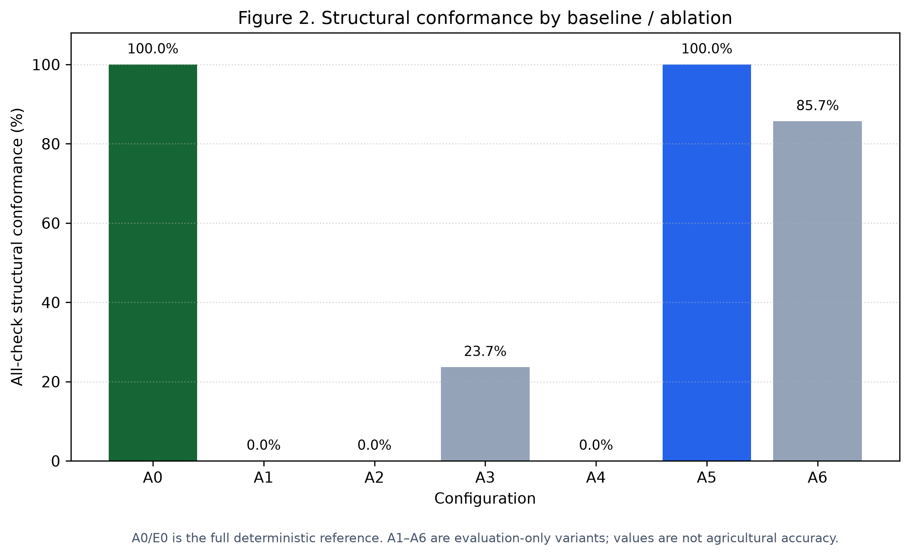
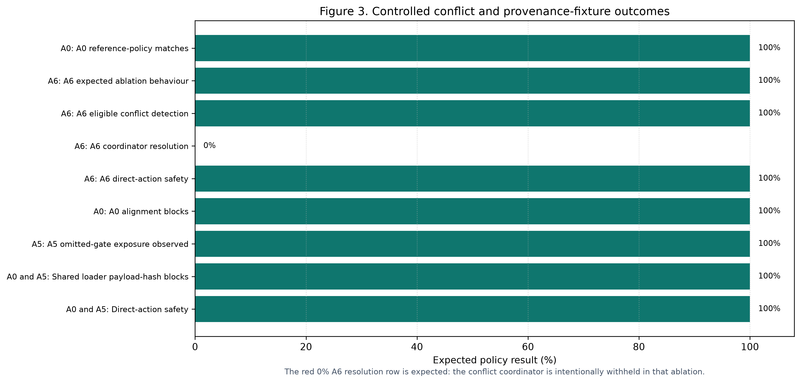
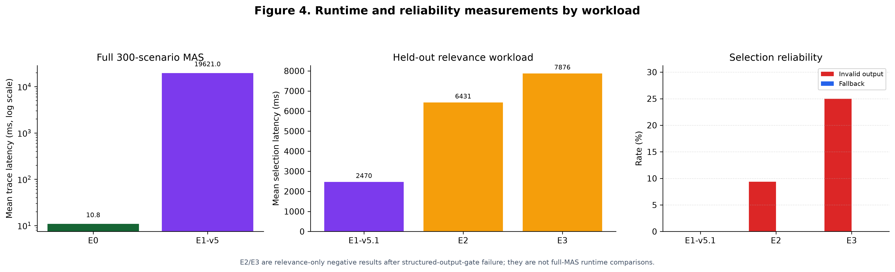

# Results and Evaluation — Official v2.2 Release

This is the readable interpretation of the final evidence release for the
**Multi-Agent Smart Agriculture Decision System – A RAG-Grounded Multi-Agent
Framework for Multimodal Decision Support in Precision Agriculture**.

Only the 19 versioned archives listed in
[OFFICIAL_V2_2_RELEASE_MANIFEST.json](../results/v2_2-paper-artifacts/OFFICIAL_V2_2_RELEASE_MANIFEST.json)
support the current paper. The [results index](../results/README.md) separates
those official archives from the frozen support inputs retained for active
evaluation code. Earlier runs were not deleted; they are excluded from every
v2.2 number, figure, and claim in the dated
[recoverable archive](../results/archive/2026-10-12-pre-v2_2/).

For the exact meaning of every E0/A0--A6/E1--E3 identifier and the purpose of
each JSON, CSV, trace, fixture, preflight, comparison, and release file, use
the companion
[Experiment Configuration and Archive Guide](EXPERIMENT_CONFIGURATION_AND_ARCHIVE_GUIDE.md).
This document remains the canonical home for the numerical values, formulas,
denominators, and result interpretation.

## 1. Frozen evaluation population

| Item | Final v2.2 value | Evidence source |
| --- | ---: | --- |
| Crops | 6 | Rice, wheat, maize, chickpea, soybean, tomato. |
| Verified study sites | 30 | Evidence-gated crop × district × season registry. |
| States / districts | 5 / 23 | District scale; never individual-farm scope. |
| Normal scenarios | 300 | Same fixed population for E0, E1-v5, and A1–A6. |
| Conflict / provenance fixtures | 60 / 60 | Controlled policy tests, not farm observations. |
| Official RAG | 92 documents / 4,582 chunks | Scenario-metadata-scoped official corpus. |
| Regional-plan evidence | 1,507 items / 41 source-quoted operations | Calendar, nutrient, IPM, and conditional-operation material. |
| Post-harvest evidence | 700 conditional items / 14 exact-crop passages | Handling and static logistics context, never live booking/capacity. |
| Final held-out relevance set | 96 questions / 8 roles | Frozen source-derived LLM selection test, disjoint from development. |

The complete source-derived composition is [Table 1](../results/v2_2-paper-artifacts/TABLE_1_DATASET_COMPOSITION.md).
Every normal run uses identical frozen scenarios, evidence/enrichment records,
RAG scope, operation bindings, prompts, candidate packages, and Oracle v1.4
schema.

## 2. Interpretation boundary

The evaluation measures structural source alignment, provenance, scope,
condition preservation, safe abstention, retrieval gating, conflict policy,
and bounded evidence selection. It does not contain field-level outcome
labels, live soil moisture, field N/P/K tests, observed crop stage, diagnosed
disease, aligned leaf images, or live facility availability.

Therefore, no reported percentage is irrigation accuracy, fertilizer-dose
accuracy, pesticide-treatment accuracy, disease-diagnosis accuracy, yield
impact, market-profit accuracy, farmer adoption, or generic agricultural
accuracy. The supported claims are limited to the source-grounded system and
evaluation boundaries explicitly described here.

## 3. Exact metric formulas, denominators, and input data

Let N be the evaluated record count; b(i,j) be binary Oracle check j for
scenario i; and C(i) be the complete set of 20 Oracle v1.4 checks for that
scenario. All values below are computed from persisted records—never entered
manually.

| Metric | Formula | Data used | Meaning |
| --- | --- | --- | --- |
| Per-check structural rate | sum_i b(i,j) / N | Each aggregate_oracle_result.json | Fraction satisfying one named source/safety rule. |
| All-check structural pass rate | sum_i 1[all j in C(i): b(i,j)=1] / N | Per-scenario Oracle results | Complete trace conformance; not farm outcome accuracy. |
| Grounded-plan / operation / citation / RAG / safety rate | Same per-check formula | Corresponding Oracle v1.4 binary check | Compliance with that exact contract boundary. |
| Direct farm-action count | sum_i 1[direct_farm_action_issued_i] | Persisted BenchmarkRun decisions | Must be zero under this public-data-only scope. |
| Fact precision | TP / (TP + FP) | Selected versus expected held-out fact IDs | Correctness of selecting already admitted evidence. |
| Fact recall | TP / (TP + FN) | Same frozen fact IDs | Coverage of expected admitted evidence. |
| Exact RAG precision / recall | Same formulas, restricted to named passage IDs | Held-out source-scoped operation questions | Exact passage selection, not free-form-answer truth. |
| Plan/operation exact selection | exact ID-set matches / eligible questions | Held-out expected plan/operation ID sets | Exact set equality. |
| Safe-empty accuracy | correct empty selections / safe-empty questions | Held-out questions with no expected facts | Correct refusal to invent authorization. |
| Invalid-output / fallback rate | count / all LLM responses | Bounded-client result status | Structured-output reliability and visible safe fallback frequency. |
| Fixture-policy compliance | passed fixtures / fixture count | Separate 60-case fixture outputs | Agreement with labelled policy behavior. |
| Reproducibility match rate | exact normalized matches / compared records | Clean-checkout verifier output | Semantic trace repeatability; latency is excluded. |
| Mean trace latency | sum_i latency_i / N | Persisted run metadata | Hardware-specific descriptive runtime, not a cross-machine benchmark. |

### 3.1 Final held-out selection numerators

The source of all bounded-LLM quality values is the one-time immutable E1-v5.1
held-out run in [results/e1-v5-heldout-final](../results/e1-v5-heldout-final/).
Its 96 records produce the following exact aggregate counts:

| Metric | Numerator / denominator | Result |
| --- | ---: | ---: |
| Fact precision | 71 true-positive selected IDs / 72 selected IDs | 98.6% |
| Fact recall | 71 true-positive selected IDs / 72 expected IDs | 98.6% |
| Exact RAG-passage precision | 12 / 12 selected IDs | 100.0% |
| Exact RAG-passage recall | 12 / 12 expected IDs | 100.0% |
| Exact plan/operation selection | 30 / 30 eligible questions | 100.0% |
| Safe-empty selection | 30 / 30 safe-empty questions | 100.0% |
| Invalid structured outputs | 0 / 96 responses | 0.0% |
| Safe fallbacks | 0 / 96 responses | 0.0% |

The pre-registered minimums were 80% fact precision/recall and safe-empty
accuracy, 75% exact passage precision/recall, and maximum 2% invalid-output
and fallback rates. The frozen
[acceptance report](../results/e1-v5-heldout-final/final_acceptance_report.json)
shows every criterion passed. The 96 per-question records preserve expected
IDs, selected IDs, latency, prompt hash, and any fallback/invalid event.

## 4. Oracle v1.4: 20 independent normal-scenario checks

overall_structural_pass is derived only when all 20 checks below pass. The
aggregate JSON has 21 metric rows because it includes that derived aggregate;
it is not a 21st independent check.

| Group | Checks |
| --- | --- |
| Identity and provenance | input_lineage_integrity; stable_claim_identity_fidelity; claim_scope_contract_compliance; citation_traceability; context_source_provenance_binding; source_quote_locator_hash_fidelity |
| Scoped evidence and plans | rag_scope_compliance; operation_binding_and_condition_compliance; conditional_operation_completeness; grounded_plan_coverage; plan_and_selected_operation_citation_coverage |
| Farmer-message fidelity | farmer_message_condition_and_citation_fidelity; farmer_message_source_detail_and_facility_fidelity |
| Safety boundaries | unsupported_action_prevention_and_agent_permissions; abstention_reason_coverage; vision_no_data_boundary |
| Conflict/signal policy | conflict_trace_completeness_and_exclusion; conflict_resolution_citation_fidelity; natural_ndvi_weather_divergence_policy |
| Bounded model trace | bounded_llm_trace_compliance |

The Oracle is a separate downstream implementation. It cannot modify agent
claims, retrieval, the coordinator decision, or the farmer message. Its
expectations still arise from the frozen source artifacts, so this is
independent implementation validation—not independent farm ground truth.

## 5. Official 300-scenario outcomes

### 5.1 Full-MAS references

| Configuration | All-check structural result | Direct actions | Bounded LLM calls | Interpretation |
| --- | ---: | ---: | ---: | --- |
| E0 / A0 deterministic MAS | 300/300 (100.0%) | 0 | 0 | Source-grounded deterministic reference. |
| E1-v5 bounded-LLM MAS | 300/300 (100.0%) | 0 | 2,400 accepted | Same structural authority; bounded selection/presentation only. |

E0's 300/300 is expected reference behavior. All normal records were admitted
only after identity, source, scope, and hash gates passed; E0 deterministically
preserves that contract. The precise claim is **100% conformance with the
frozen structural evidence-and-safety contract**, never 100% agriculture or
farmer-decision accuracy.

E1-v5 cannot change an operation, safety restriction, direct-action flag, or
citation set. Across the 300 paired E0/E1 records, decision status, operation
status/text, direct-action status, and citation sets were unchanged. The model
may only select/order already admitted presentation cards.

### 5.2 Architecture comparisons

| System | All checks | Plan coverage | Conditional operations | Plan citations | Conflict trace | Safety / permissions |
| --- | ---: | ---: | ---: | ---: | ---: | ---: |
| A0 full MAS | 300/300 (100.0%) | 300/300 | 300/300 | 300/300 | 300/300 | 300/300 |
| A1 regional-plan-only | 0/300 (0.0%) | 300/300 | 0/300 | 101/300 | 300/300 | 300/300 |
| A2 centralized scoped RAG | 0/300 (0.0%) | 0/300 | 0/300 | 0/300 | 300/300 | 300/300 |
| A3 without scoped RAG/recovery | 71/300 (23.7%) | 300/300 | 71/300 | 197/300 | 300/300 | 300/300 |
| A4 without regional plans | 0/300 (0.0%) | 0/300 | 71/300 | 0/300 | 300/300 | 300/300 |
| A5 without alignment gate | 300/300 (100.0%) | 300/300 | 300/300 | 300/300 | 300/300 | 300/300 |
| A6 without conflict coordinator | 257/300 (85.7%) | 300/300 | 300/300 | 300/300 | 257/300 | 300/300 |

A1/A2 are intentionally incomplete evaluation baselines, not farmer-facing
systems. A3 loses complete operation support for 229 traces when scoped
recovery is withheld; that is a structural coverage loss, not yield or
financial loss. A5 equals A0 only because normal inputs are already valid;
malformed fixtures measure its missing protection. A6 has 43 natural,
non-actionable NDVI–weather divergences without the required coordinator trace.

The canonical detail is [Table 3](../results/v2_2-paper-artifacts/TABLE_3_MAIN_STRUCTURAL_RESULTS.md).

## 6. Conflict and provenance fixtures

Fixtures are labelled in-memory policy overlays. They never become additional
scenarios and never claim to be historical farm observations.

| Fixture result | Final v2.2 outcome | Meaning |
| --- | ---: | --- |
| A0 conflict-policy cases | 60/60 | Coordinator follows stored source/scope/time/safety precedence policy. |
| A6 expected ablation behavior | 60/60 | Detection/safety remain while coordinator resolution is withheld. |
| A6 eligible conflict detection | 48/48 | Coordinator-required same-domain conflicts remain visible. |
| A6 coordinator resolutions | 0/48 | Zero by design: demonstrates the coordinator's causal role. |
| A0 alignment-validator blocks | 50/50 | Mismatched plan identity/binding records stop before downstream agents. |
| A5 omitted-gate exposure | 50/50 | Expected exposure after removing the validator; runner halts there. |
| Shared raw-payload hash blocks | 10/10 | Loader-level hash gate remains active for A0 and A5. |
| Direct actions on invalid fixtures | 0/60 | Invalid bundles never issue a decision or farm action. |

See [Table 5](../results/v2_2-paper-artifacts/TABLE_5_CONFLICT_RESOLUTION.md)
and [Table 6](../results/v2_2-paper-artifacts/TABLE_6_PROVENANCE_GATE.md).

## 7. Bounded-LLM, Apple-GPU, and transfer results

The accepted model-enabled path is E1-v5.1: Ollama,
qwen2.5:7b-instruct, temperature 0.0, with Apple Metal. The preflight verified
4,638,040,390 GPU-resident model bytes for the bound Q4_K_M artifact. It
queries Ollama residency directly; PyTorch MPS is not treated as proof of
Ollama acceleration.

| Role / aggregate | Fact precision / recall | Safe empty | Exact RAG precision / recall | Mean latency |
| --- | ---: | ---: | ---: | ---: |
| Weather, soil, satellite, market | 100.0% / 100.0% each | 100.0% where applicable | — | 2.1–2.3 s |
| Fertilizer baseline | 100.0% / 100.0% | — | — | 2.0 s |
| Official operations RAG | 100.0% / 100.0% | — | 100.0% / 100.0% | 2.0 s |
| Coordinator | 100.0% / 100.0% | — | — | 4.4 s |
| Farmer explanation | 83.3% / 83.3% | 100.0% | — | 2.5 s |
| Overall, 96 questions | 98.6% / 98.6% | 100.0% | 100.0% / 100.0% | 2.47 s |

The two non-matching fact selections are in the farmer-explanation role. They
do not authorize any action because that role is non-authoritative. Per-role
values and thresholds are in [Table 4](../results/v2_2-paper-artifacts/TABLE_4_BOUNDED_LLM_RELEVANCE.md).

| Full-MAS workload | Scenarios | Structural pass | LLM calls | Mean trace latency | Peak MiB | Wall time |
| --- | ---: | ---: | ---: | ---: | ---: | ---: |
| E0 deterministic | 300 | 300/300 | 0 | 10.8 ms | 621.3 | 4.0 s |
| E1-v5 model-enabled | 300 | 300/300 | 2,400 | 19,621.0 ms | 465.5 | 5,889.0 s |

E2 (Ollama 14B) and E3 (MLX-LM 14B 4-bit) both verified Apple GPU use but
failed the same maximum 2% invalid structured-output gate: E2 had 9/96 (9.4%)
and E3 had 24/96 (25.0%) invalid responses. Neither was admitted to a pilot or
full-MAS batch. They are transparent deployment-admission negative results,
not safety, farmer-output, or agricultural-outcome comparisons. Because their
artifacts/quantization are not byte-identical, they are not a pure
Ollama-versus-MLX runtime experiment. See [Table 10](../results/v2_2-paper-artifacts/TABLE_10_14B_TRANSFER_NEGATIVE_RESULTS.md).

## 8. Stratification and reproducibility

All six crop strata retain A0's 100% structural conformance. A3's remaining
complete-operation traces are wheat 29/50, soybean 22/50, rice 16/50, maize
4/50, and chickpea/tomato 0/50 after source-scoped operation recovery is
withheld. This describes source-coverage variation; it is not a crop yield,
health, or difficulty ranking. District results are in
[Table 7](../results/v2_2-paper-artifacts/TABLE_7_STRATIFIED_CONFORMANCE.md).

The final clean-checkout verification confirmed 57/57 frozen-artifact hashes,
300/300 exact E0 structural fingerprints/check vectors/semantic traces and
farmer messages, plus exact 60/60 conflict and 60/60 provenance fixture policy
traces. It also refreshed E1 Apple-Metal evidence. The archive is
[v2_2-final-reproducibility-2026-10-12](../results/v2_2-final-reproducibility-2026-10-12/).

## 9. Paper-ready package and supported conclusion

The Phase 10 package contains ten generated tables, four figures, case studies,
runtime summaries, and hash manifests:
[Table 1](../results/v2_2-paper-artifacts/TABLE_1_DATASET_COMPOSITION.md),
[Table 2](../results/v2_2-paper-artifacts/TABLE_2_AGENT_RESPONSIBILITIES.md),
[Table 3](../results/v2_2-paper-artifacts/TABLE_3_MAIN_STRUCTURAL_RESULTS.md),
[Table 4](../results/v2_2-paper-artifacts/TABLE_4_BOUNDED_LLM_RELEVANCE.md),
[Table 5](../results/v2_2-paper-artifacts/TABLE_5_CONFLICT_RESOLUTION.md),
[Table 6](../results/v2_2-paper-artifacts/TABLE_6_PROVENANCE_GATE.md),
[Table 7](../results/v2_2-paper-artifacts/TABLE_7_STRATIFIED_CONFORMANCE.md),
[Table 8](../results/v2_2-paper-artifacts/TABLE_8_CASE_STUDIES.md),
[Table 9](../results/v2_2-paper-artifacts/TABLE_9_RUNTIME_AND_BACKEND.md), and
[Table 10](../results/v2_2-paper-artifacts/TABLE_10_14B_TRANSFER_NEGATIVE_RESULTS.md).

The defensible paper claim is:

> On a frozen public-data-only Indian benchmark spanning six crops, 30
> verified crop–site contexts, and 300 aligned historical scenarios, the
> provenance-constrained MAS produced source-scoped regional plans, preserved
> evidence conditions and safety boundaries, handled controlled provenance
> conflicts, and reproduced its deterministic reference traces exactly—without
> issuing unsupported farm-specific actions.

It does not support claims of field-action accuracy, intervention efficacy,
yield/profit improvement, farmer adoption, or live advisory deployment.
