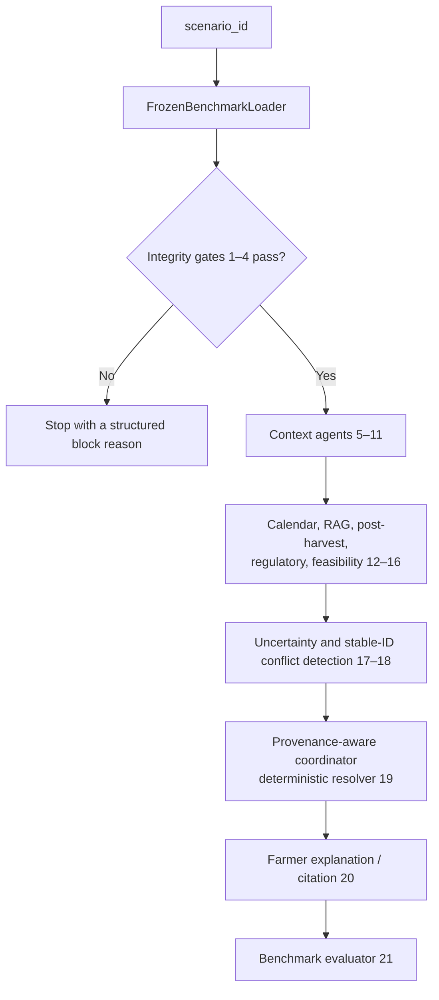

# Multi-Agent Smart Agriculture Decision System

## A RAG-Grounded Multi-Agent Framework for Multimodal Decision Support in Precision Agriculture

This repository contains a provenance-constrained research system for
source-grounded agricultural decision support. Its active research path runs
from a frozen, verified Indian agriculture benchmark rather than from manually
entered farm data, sample JSON, or live API responses.

The project is intentionally evidence-bounded. It produces source-cited
regional plans and conditional technical operations, but does not pretend that
public historical sources observe an individual farm's current moisture, crop
stage, soil nutrients, disease, harvested lot, or storage availability.

## Current research system

| Component | Current implementation |
|---|---|
| Study scope | Six crops: rice, wheat, maize, chickpea, soybean, and tomato; five verified districts per crop. |
| Frozen benchmark | 30 admitted crop × district × season study sites and 300 all-gate-passing historical scenarios. |
| Evidence layers | Registry/scenarios plus four additive enrichments: contextual evidence, official RAG/action evidence, regional operation plans, and post-harvest/storage/logistics context. |
| MAS workflow | A fail-closed LangGraph pipeline with 21 small, separately reviewable agent roles. |
| RAG | Metadata-filtered official corpus plus source-scoped operation passages and exact-crop post-harvest passages. |
| LLM use | Optional bounded relevance selection in eight roles; deterministic code remains authoritative for evidence, safety, citations, and action status. |
| Direct farm actions | None. The benchmark does not contain the field observations required to safely issue them. |

Every scenario aligns crop, district, state, declared season, representative
cropland cell, decision window, weather, soil, satellite metadata, market
report, and regional management evidence. No synthetic weather, disease,
market, fertilizer, or post-harvest event is introduced.

## What a farmer-facing result can contain

For a frozen scenario, the system can render a concise, citation-preserving
plan with:

1. regional seasonal calendar context;
2. regional nutrient-policy and IPM-policy references;
3. a time-valid official operation when the source and scenario binding pass,
   retaining any unobserved field condition;
4. a crop-scoped conditional post-harvest handling card; and
5. limited historical weather, soil, satellite, or market context when it is
   relevant and source-supported.

The system will not invent an irrigation order, NPK dose, disease diagnosis,
chemical treatment, warehouse booking, transport instruction, storage
duration, or sell/hold recommendation.

## Architecture



The full agent catalogue, inputs, outputs, data handoffs, and safety limits
are in [Documentation/AGENTS.md](Documentation/AGENTS.md).

### Post-harvest/storage/logistics layer

The fourth enrichment adds 700 crop-scoped conditional handling plan items
across all 300 scenarios, 14 exact-crop RAG passages, collection-date public
facility/warehouse context, and static route context. Its deterministic agent
can expose only source-linked handling claims and clearly labelled
infrastructure context. It cannot infer lot readiness, commodity acceptance,
capacity, vacancy, booking, dispatch, freight, transport availability, or a
sell/hold outcome.

See [post-harvest enrichment documentation](data/scenarios/enriched/POSTHARVEST_LOGISTICS_ENRICHMENT.md)
and its [audit](data/scenarios/enriched/POSTHARVEST_LOGISTICS_AUDIT.md).

## Quick start

### 1. Create the platform-specific environment

The project keeps Windows and macOS environments separate. The existing
Windows environment is not changed by macOS setup.

On macOS (Python 3.12 recommended):

```bash
bash scripts/setup_macos.sh
```

On Windows, create and activate a Python 3.12 virtual environment, then install
the same dependencies:

```powershell
py -3.12 -m venv venv
.\venv\Scripts\Activate.ps1
python -m pip install --upgrade pip
pip install -r requirements.txt
```

### 2. Verify the frozen research system

On macOS:

```bash
.venv-macos/bin/python -m pytest -q
```

The current release-hygiene validation passes **193 tests** (42.04 seconds).
It validates loader integrity,
source hashes, enrichment scope, typed-claim safety, RAG admissibility,
post-harvest boundaries, bounded-LLM validation, all stored conflict-fixture
policy outcomes, and the source-derived oracle's normal, adversarial, and
stratified-result paths.

The test migration resolves historical comparison and held-out path references
through their official v2.2 or recoverable-archive locations. It did not
modify any frozen v2.2 evidence archive, hash, prompt, model result, or paper
metric.

## Completed reproducibility release

Earlier clean-checkout E0/E1 semantic-repeatability evidence is preserved as
historical material. The final v2.2 release check is the official current
verification: it reproduced E0 and both 60-fixture suites exactly, verified
57/57 frozen artifacts, and refreshed bound E1 Metal evidence. Its committed
archive is
[results/v2_2-final-reproducibility-2026-10-12](results/v2_2-final-reproducibility-2026-10-12/).

The project does not fine-tune Qwen model weights. It uses a frozen Qwen2.5
7B artifact and developed role-specific prompts/candidate packages on a
separate development set before one held-out v5.1 evaluation. See
[Approach](Documentation/Approach.md) and
[Files Information](Documentation/FILES_INFORMATION.md) for the complete
method, results formulas, and current-versus-legacy file classification.

## Paper-ready results package

Phase 10 is complete. The read-only presentation package in
[`results/v2_2-paper-artifacts`](results/v2_2-paper-artifacts/) is regenerated only from
frozen data, persisted result archives, and the agent contract. It contains:

- ten paper tables covering benchmark composition, agent responsibilities,
  structural/ablation results, held-out bounded-LLM relevance, fixtures,
  strata, case studies, runtime, and the E2/E3 verified-acceleration but
  blocked-deployment result;
- four PNG/PDF figures for architecture, ablations, controlled fixtures, and
  runtime/reliability; and
- source-traceable case studies, CSV summaries, and a SHA-256 input/output
  manifest.

The separate [official v2.2 evidence-release manifest](results/v2_2-paper-artifacts/OFFICIAL_V2_2_RELEASE_MANIFEST.json)
freezes the paper result boundary to the 19 explicitly named `v2_2-*` result
archives and excludes historical generations.

Earlier outputs are preserved, rather than deleted, under
[`results/archive/2026-10-12-pre-v2_2/`](results/archive/2026-10-12-pre-v2_2/).
They are recoverable research history and must not be mixed into v2.2 tables,
figures, or claims. The live [results index](results/README.md) distinguishes
the official v2.2 evidence, the few frozen support inputs required by current
evaluation code, and the archive.

These materials report structural conformance, bounded evidence-selection
quality, fixture-policy behavior, and runtime measurements—not farm-outcome
or agricultural-accuracy claims. The canonical interpretation is in
[Documentation/RESULTS.md](Documentation/RESULTS.md).

### 3. Run one deterministic benchmark scenario

```bash
.venv-macos/bin/python - <<'PY'
from graph.benchmark_workflow import BenchmarkMASWorkflow

run = BenchmarkMASWorkflow().run(
    "ANCHOR_PF_PB_LUDHIANA_RICE_KHARIF_20251130",
    question="What source-backed regional plan is relevant for this scenario?",
)
print(run.farmer_message)
print(run.evaluation)
PY
```

The default benchmark run is deterministic and offline with respect to LLM
calls. It reads only the frozen project artifacts and verifies their hashes by
default.

### 4. Run the controlled conflict-policy suite

The normal workflow deliberately never loads counterfactual test evidence.
Use the separate runner to exercise the production conflict detector,
integrity validators, and deterministic coordinator against the stored
evaluation-only overlays:

```bash
.venv-macos/bin/python - <<'PY'
from evaluation.conflict_fixture_runner import ConflictFixtureRunner

runs = ConflictFixtureRunner().run_all()
assert len(runs) == 60
assert all(run.expected_match for run in runs)
print("All 60 conflict-policy fixtures passed.")
PY
```

These are controlled provenance and gate tests, not simulated farm events or
farmer-facing recommendations. The runner loads each real base scenario, adds
only an in-memory labelled overlay, and never writes into the normal benchmark
or its output path.

### 5. Run the provenance/alignment integrity-fixture suite

This separate fixture suite tests whether the alignment validator actually
protects the otherwise-clean frozen benchmark. It never runs an invalid bundle
through context agents, coordination, or farmer-message rendering:

```bash
.venv-macos/bin/python -m evaluation.provenance_fixture_runner \
  --output-dir results/local-provenance-gate-fixtures
```

The expected result is 60/60: A0 blocks 50 controlled plan identity/binding
mismatches, A5 exposes those 50 only at its deliberately omitted-gate
evaluation boundary, and the shared loader blocks 10 payload-hash mismatches.
No fixture creates a direct farm action.

### 6. Audit one completed run with the external oracle

The oracle is outside the farmer-facing workflow. It compares the completed
trace with the immutable scenario evidence and returns 20 binary structural
checks plus a deterministic fingerprint:

```bash
.venv-macos/bin/python - <<'PY'
from data.benchmark_loader import FrozenBenchmarkLoader
from evaluation.benchmark_oracle import BenchmarkEvaluationOracle
from graph.benchmark_workflow import BenchmarkMASWorkflow

scenario_id = "ANCHOR_PF_PB_LUDHIANA_RICE_KHARIF_20251130"
loader = FrozenBenchmarkLoader()
scenario = loader.load(scenario_id, verify_raw_hashes=False)
run = BenchmarkMASWorkflow(loader=loader).run(scenario_id, verify_raw_hashes=False)
result = BenchmarkEvaluationOracle().evaluate(scenario, run)
assert result.overall_passed
print(result.as_dict())
PY
```

Read the [evaluation policy](Documentation/EVALUATION_POLICY.md) before
interpreting a result, and use the
[oracle evaluation guide](Documentation/ORACLE_EVALUATION_GUIDE.md) for the
20-check definitions, fixture protocol, full-300 aggregation, formulas, and
limits.

### 7. Optional bounded-LLM experiment

After installing and running Ollama with the configured local model, set:

```bash
export BENCHMARK_LLM_ENABLED=true
export BENCHMARK_LLM_REQUIRED=true
```

The same run will make exactly eight schema-constrained LLM calls per scenario.
Each call can rank only supplied immutable fact IDs. It cannot create prose,
facts, citations, conditions, doses, diagnoses, forecasts, or actions; an
invalid selection is rejected. See [the bounded-LLM boundary](Documentation/AGENTS.md#bounded-llm-boundary).

### 8. Reproduce the accepted E1-v5 Apple-Metal run

This optional path runs the complete model-enabled MAS under the accepted E1
configuration. It requires macOS, Ollama, the project virtual environment, a
clean committed checkout, and the exact bound Qwen2.5 7B Q4_K_M artifact. The
preflight fails closed if the local model identity, artifact, or Metal
residency evidence does not match the frozen protocol.

```bash
# Fetch the configured local model if it is not already available.
ollama pull qwen2.5:7b-instruct

# Record fresh Metal/GPU residency evidence for the bound E1 artifact.
.venv-macos/bin/python -m evaluation.apple_gpu_preflight \
  --configuration E1 \
  --output-dir /tmp/mas-e1-v5-preflight

# Run the complete 300-scenario E1-v5 MAS without replacing accepted archives.
BENCHMARK_LLM_ENABLED=true \
BENCHMARK_LLM_REQUIRED=true \
LLM_BACKEND=ollama \
OLLAMA_MODEL=qwen2.5:7b-instruct \
.venv-macos/bin/python -m evaluation.benchmark_batch_runner \
  --configuration E1 \
  --output-dir /tmp/mas-e1-v5-rerun \
  --acceleration-evidence-json /tmp/mas-e1-v5-preflight/acceleration_evidence.json
```

Ollama's recorded Metal GPU residency—not PyTorch MPS availability—is the
accepted acceleration evidence for this runtime. Compare a formal clean-
checkout rerun with the accepted archive using
[REPRODUCIBILITY_VERIFICATION.md](Documentation/REPRODUCIBILITY_VERIFICATION.md).

## Data and reproducibility

| Need | Primary reference |
|---|---|
| Public providers, exact URLs, citations, and source restrictions | [Documentation/DATA_SOURCES.md](Documentation/DATA_SOURCES.md) |
| Final six-crop, 30-site registry | [data/registry/README.md](data/registry/README.md) |
| Frozen 300-scenario benchmark | [data/scenarios/README.md](data/scenarios/README.md) |
| All four enrichments and their build/audit contracts | [data/scenarios/enriched/README.md](data/scenarios/enriched/README.md) |
| Fourth enrichment source/audit contract | [POSTHARVEST_LOGISTICS_ENRICHMENT.md](data/scenarios/enriched/POSTHARVEST_LOGISTICS_ENRICHMENT.md) |
| Stored evaluation-only conflict fixtures | [data/conflict_fixture_registry/README.md](data/conflict_fixture_registry/README.md) |
| Stored evaluation-only provenance/alignment fixtures | [data/provenance_fixture_registry/README.md](data/provenance_fixture_registry/README.md) |
| End-to-end implemented methodology and research pathway | [Documentation/Approach.md](Documentation/Approach.md) |
| Current project state and completed work | [Documentation/UPDATES.md](Documentation/UPDATES.md) |
| Active paper-writing and release work | [Documentation/To-Do.md](Documentation/To-Do.md) |
| Evaluation policy, evidence boundaries, and conflict-resolution measures | [Documentation/EVALUATION_POLICY.md](Documentation/EVALUATION_POLICY.md) |
| Executable oracle guide, result schema, and reproduction commands | [Documentation/ORACLE_EVALUATION_GUIDE.md](Documentation/ORACLE_EVALUATION_GUIDE.md) |
| Frozen experiment configurations, comparisons, and acceptance gates | [Documentation/EXPERIMENT_PROTOCOL.md](Documentation/EXPERIMENT_PROTOCOL.md) |
| Exact E0/A0–A6/E1–E3 meanings and official result-file/archive decoder | [Documentation/EXPERIMENT_CONFIGURATION_AND_ARCHIVE_GUIDE.md](Documentation/EXPERIMENT_CONFIGURATION_AND_ARCHIVE_GUIDE.md) |
| Readable benchmark results, exact formulas, numerators, and interpretation limits | [Documentation/RESULTS.md](Documentation/RESULTS.md) |
| Official v2.2 result/archive navigation | [results/README.md](results/README.md) |
| Paper-ready tables, figures, cases, and hash manifest | [results/v2_2-paper-artifacts/README.md](results/v2_2-paper-artifacts/README.md) |
| Persisted cross-run paper tables, figures, and comparison manifest | [results/v2_2-phase7-controlled-comparison/architecture-ablation/README.md](results/v2_2-phase7-controlled-comparison/architecture-ablation/README.md) |
| Final E0/E1-v5, ablation, fixture, and qualitative-inspection package | [results/v2_2-phase7-controlled-comparison/README.md](results/v2_2-phase7-controlled-comparison/README.md) |
| Guide-facing project overview | [Current Project Idea](<Documentation/Documents/Current Project Idea.md>) |
| Architecture rationale | [New Architecture Justification](<Documentation/Documents/New Architecture Justification.md>) |

### Complete documentation index

The table below is the complete index of Markdown records under
[`Documentation/`](Documentation/). It is intended for new readers: choose the
document whose contents match the question, rather than searching through the
entire repository. The shorter [Documentation map](Documentation/README.md)
identifies the canonical source for each major topic.

| Documentation file | Contents and when to read it |
| --- | --- |
| [Documentation/README.md](Documentation/README.md) | Documentation map and anti-duplication rule. Read first to identify the canonical record for a topic. |
| [Documentation/Documents/Current Project Idea.md](<Documentation/Documents/Current Project Idea.md>) | Guide-facing project overview: problem, research contribution, six-crop/30-site scope, enrichments, RAG-grounded MAS, conflict awareness, bounded LLM, evaluation, and defensible claim. |
| [Documentation/Documents/New Architecture Justification.md](<Documentation/Documents/New Architecture Justification.md>) | Architectural rationale: why the frozen loader, typed claims, 21 agents, scoped RAG, regional plans, safety policy, deterministic coordinator, bounded LLM, and evaluation design are necessary. |
| [Documentation/Approach.md](Documentation/Approach.md) | Complete end-to-end technical pathway: public-source collection, site admission, 300 scenarios, all four enrichments, 21-agent workflow, farmer-output boundary, provenance/conflicts, Oracle, E0--E3 and A0--A6 experiments, prompt/contract refinement, Apple GPU, reproducibility, and paper claim. |
| [Documentation/AGENTS.md](Documentation/AGENTS.md) | Canonical 21-agent interface reference: each agent's specific purpose, inputs, outputs, permissions, restrictions, execution order, data handoffs, `BenchmarkRun` schema, LLM boundary, and fixture role. |
| [Documentation/DATA_SOURCES.md](Documentation/DATA_SOURCES.md) | Final public-source register: providers, exact URLs, source restrictions, registry/scenario/enrichment provenance artifacts, management and regulatory documents, official RAG inventory, and fixture-source boundary. |
| [Documentation/EVALUATION_POLICY.md](Documentation/EVALUATION_POLICY.md) | Research-claim policy: what the benchmark can measure, prohibited agricultural-outcome claims, interpretation of E0/A0--A6 results, conflict/provenance fixture policy, and bounded-LLM evaluation boundary. |
| [Documentation/ORACLE_EVALUATION_GUIDE.md](Documentation/ORACLE_EVALUATION_GUIDE.md) | External Oracle implementation reference: inputs, result schema, all 20 structural checks, aggregation and strata, conflict/provenance fixture evaluation, commands, pass/failure meaning, and limits. |
| [Documentation/EXPERIMENT_PROTOCOL.md](Documentation/EXPERIMENT_PROTOCOL.md) | Frozen experiment protocol: hash-locked benchmark inputs, safety and LLM boundaries, configured runs, required comparisons, relevance evaluation sequence, persisted artifacts, and interpretation rule. |
| [Documentation/EXPERIMENT_RUNS_GUIDE.md](Documentation/EXPERIMENT_RUNS_GUIDE.md) | Scientific rationale for E0--E3 and A0--A6: why each run exists, what comparison is valid, what the run demonstrates, what it cannot demonstrate, and the model-refinement lifecycle. |
| [Documentation/EXPERIMENT_CONFIGURATION_AND_ARCHIVE_GUIDE.md](Documentation/EXPERIMENT_CONFIGURATION_AND_ARCHIVE_GUIDE.md) | Exact decoder for E0/A0--A6/E1--E3 identifiers and official archives: system changes, results, archive-file meanings, E2/E3 admission outcome, and permitted interpretation. |
| [Documentation/RESULTS.md](Documentation/RESULTS.md) | Canonical v2.2 numerical-results record: evaluation population, formulas and denominators, Oracle outcomes, ablation results, fixture results, held-out LLM metrics, runtime, strata, reproducibility, paper-artifact links, and supported conclusion. |
| [Documentation/BOUNDED_LLM_RELEVANCE_BENCHMARK.md](Documentation/BOUNDED_LLM_RELEVANCE_BENCHMARK.md) | Historical E1-v4 96-question relevance benchmark: eight bounded roles, question schema, admissible fact/passage IDs, safe-empty boundary, integrity checks, metrics, and its status as a diagnostic baseline. |
| [Documentation/E1_RELEVANCE_ERROR_ANALYSIS.md](Documentation/E1_RELEVANCE_ERROR_ANALYSIS.md) | Diagnostic analysis of the historical v4 selection errors: safe-empty, RAG-passage, fertilizer-boundary, and coordinator errors that motivated v5/v5.1 changes. |
| [Documentation/BOUNDED_LLM_RELEVANCE_DEVELOPMENT_SET.md](Documentation/BOUNDED_LLM_RELEVANCE_DEVELOPMENT_SET.md) | Disjoint development-only 96-question set: challenge families, integrity boundary, permitted prompt/candidate-package iteration, development-run labeling, and the rule that it is not a final result. |
| [Documentation/BOUNDED_LLM_V5_SELECTION_CONTRACT.md](Documentation/BOUNDED_LLM_V5_SELECTION_CONTRACT.md) | Frozen v5.1 selector contract: sufficiency-first rule, safe-empty behavior, role-specific prompt/candidate policies, allowed authority, structured-ID constraints, and final evaluation status. |
| [Documentation/BOUNDED_LLM_V5_HELDOUT_PROTOCOL.md](Documentation/BOUNDED_LLM_V5_HELDOUT_PROTOCOL.md) | Final immutable v5.1 96-question held-out protocol: unseen sites, pre-registered thresholds, hash checks, one-time run sequence, artifacts, and accepted final metrics. |
| [Documentation/APPLE_GPU_PREFLIGHT.md](Documentation/APPLE_GPU_PREFLIGHT.md) | E1 Apple-Metal hardware proof: frozen 30-site pilot population, bound Qwen 7B artifact, Metal-residency evidence, command shape, and the distinction between GPU configuration and agricultural evaluation. |
| [Documentation/PHASE8_14B_EXPERIMENTS.md](Documentation/PHASE8_14B_EXPERIMENTS.md) | E2/E3 14B transfer experiments: Ollama and MLX artifact boundary, GPU preflights, relevance-transfer metrics, structured-output gate failures, non-admission to full MAS, and appropriate negative-result interpretation. |
| [Documentation/REPRODUCIBILITY_VERIFICATION.md](Documentation/REPRODUCIBILITY_VERIFICATION.md) | Official v2.2 reproducibility record: 57 frozen-artifact hashes, E0 and fixture equality rules, E1 runtime boundary, future reproduction commands, and mismatch policy. |
| [Documentation/UPDATES.md](Documentation/UPDATES.md) | Concise chronological project history: registry/scenarios, four enrichments, MAS implementation, fixtures, Oracle, LLM development, E2/E3, reproducibility, paper artifacts, and release archive. |
| [Documentation/To-Do.md](Documentation/To-Do.md) | Current paper-writing/release checklist, final audit items, reproducibility appendix tasks, and clearly separated future research extensions. |
| [Documentation/FILES_INFORMATION.md](Documentation/FILES_INFORMATION.md) | Repository inventory and version classification: active data/code/scripts/tests/results, purpose of each file or folder, historical archives, local-only material, and explicit legacy-project list. |
| [Documentation/MAS_BASELINE_AUDIT.md](Documentation/MAS_BASELINE_AUDIT.md) | Boundary between the original prototype and the current benchmark MAS: preserved legacy baseline, identified gaps, completed foundation/runtime work, and confirmation that legacy code does not enter paper results. |

## Official v2.2 evaluation status

All paper-facing values come from the 19 archives in the official v2.2 release
manifest. E0/A0 and E1-v5 both achieved 300/300 complete structural-contract
passes on the same frozen scenarios, with zero unsupported direct farm actions.
E1-v5 made 2,400 accepted bounded selections; its one-time 96-question
held-out test achieved 71/72 fact-ID true positives (98.6% precision and
recall), 30/30 safe-empty selections, 12/12 exact RAG-passage selections, and
zero invalid or fallback responses. These are source-selection and structural
conformance measures, not farm-outcome accuracy.

The A1–A6 comparison is A0 300/300, A1 0/300, A2 0/300, A3 71/300, A4 0/300,
A5 300/300 valid normal inputs, and A6 257/300. The two fixture suites provide
the causal boundary not exposed by valid normal inputs: A0 follows 60/60
conflict-policy fixtures and blocks 50/50 malformed alignment bindings; A5
exposes the 50 validator-omission cases only in evaluation mode. E2 and E3
verified Apple-GPU use but failed the pre-registered structured-output gate
(9/96 and 24/96 invalid outputs), so neither advanced to a full MAS run.

Oracle v1.4 evaluates **20 independent binary checks**. A complete structural
pass is `scenarios passing all 20 checks / 300`; the aggregate report includes
one additional derived `overall_structural_pass` row. The final held-out
selector percentages use `TP/(TP+FP)` for precision and `TP/(TP+FN)` for
recall. Exact numerators, denominators, source files, formulas, and allowed
interpretations are in [Documentation/RESULTS.md](Documentation/RESULTS.md).

The full controlled comparison, both fixture suites, 72 reporting strata, and
non-scored farmer-plan examples are in
[results/v2_2-phase7-controlled-comparison](results/v2_2-phase7-controlled-comparison/).
For the purpose and valid interpretation of every E0–E3 and A0–A6 run, read
[Documentation/EXPERIMENT_RUNS_GUIDE.md](Documentation/EXPERIMENT_RUNS_GUIDE.md).

### Running a new local benchmark safely

The runner persists a complete `BenchmarkRun`, Oracle result, manifest,
aggregate report, and stratified report for each frozen scenario. It refuses a
dirty required worktree, altered protocol artifact, unknown scenario ID, or
existing output directory. Never overwrite an official v2.2 archive.

```bash
.venv-macos/bin/python -m evaluation.benchmark_batch_runner \
  --configuration E0 \
  --output-dir results/local-e0-benchmark
```

The A1–A6 systems require `--evaluation-only` and are never farmer-facing.
Use the reproduction guidance in
[Documentation/REPRODUCIBILITY_VERIFICATION.md](Documentation/REPRODUCIBILITY_VERIFICATION.md)
to compare any local run with the official v2.2 release.

## Legacy prototype retained as a baseline

The repository also retains the earlier prototype (`main.py`, `graph/workflow.py`,
legacy `agents/`, generic knowledge-base documents, and optional vision/data
experiments). It accepts caller-supplied or live/demo inputs and is preserved
for baseline comparison only. It is not connected to the frozen research
workflow and must not be used to make claims about the current benchmark.

See [Documentation/MAS_BASELINE_AUDIT.md](Documentation/MAS_BASELINE_AUDIT.md)
for the exact boundary between the legacy prototype and the active benchmark
MAS.

## License and public-source use

### Code

This repository currently has **no separate `LICENSE` file**. This README does
not grant an open-source license or alter the copyright status of the code.
Contact the repository owner before redistributing, relicensing, or using the
code outside the intended research context. A future public release should add
an explicit license file before making broader reuse claims.

### Public data and documents

The benchmark uses public or institutional sources, but those source materials
remain subject to each provider's own terms, attribution requirements, and
licensing conditions. The project preserves source URLs, hashes, retrieval
metadata, scope restrictions, and intended-use boundaries; it does not claim
ownership of third-party data or documents. See
[Documentation/DATA_SOURCES.md](Documentation/DATA_SOURCES.md) for the exact
providers, links, citations, and source-specific use notes.
